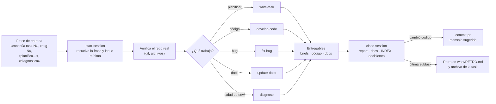
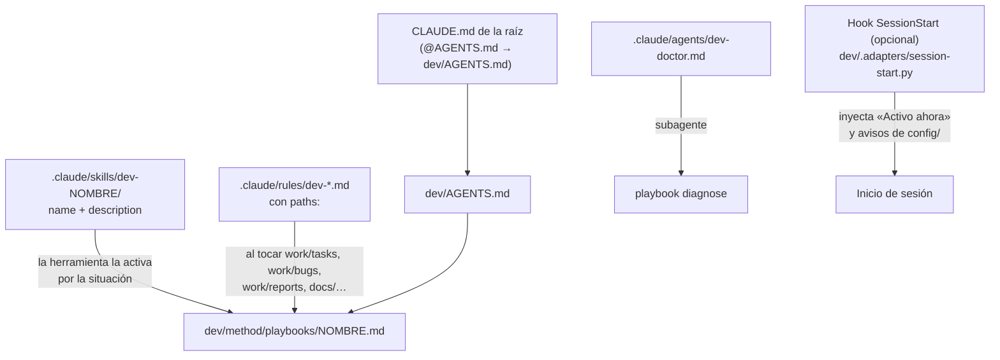

# MAPA — cómo está hecho el método

**Fecha:** 2026-10-28 · **Verificado contra:** paquete 0.8.0

Para personas: sirve para auditar por qué el agente leyó o ignoró algo sin leer todos los playbooks. El agente no lo lee en cada sesión. Lo reemplaza el paquete al actualizar, así que describe siempre la versión instalada; `check.py` avisa si un playbook o un archivo de `config/` no figura aquí.

## Contenido

1. [Carpetas y archivos](#1-carpetas-y-archivos)
2. [Flujo de una sesión](#2-flujo-de-una-sesión)
3. [Qué contexto se lee y cuándo](#3-qué-contexto-se-lee-y-cuándo)
4. [Adaptador de Claude Code](#4-adaptador-de-claude-code)

## 1. Carpetas y archivos

| Ruta | Rol | Quién lo escribe | Se reemplaza al actualizar |
|---|---|---|---|
| `AGENTS.md` | Enrutador: qué leer al empezar y qué playbook usar | Paquete | Sí |
| `config/PROJECT.md` | Reglas del proyecto: alias, idiomas, restricciones `C…`, zonas intocables | Tú | No |
| `config/ENTORNO.md` | Herramientas y servicios por etapa, cómo probar en vivo, reglas `E…` | Tú | No |
| `config/COMANDOS.md` | Stacks activos, comandos, política de commits y PR | Tú (el agente propone) | No |
| `config/DEV-PROFILE.md` | Preferencias personales; no se versiona | Tú | No |
| `work/INDEX.md` | Estado vivo («Activo ahora»), catálogo, tasks, bugs, backlog | El agente | No |
| `work/RETRO.md` | Retros del método, una fila por task cerrada | El agente | No |
| `work/tasks/` · `work/bugs/` | Un plan por carpeta: README, `decisions.md`, briefs | El agente (tú apruebas) | No |
| `work/reports/` · `work/changelogs/` | Historial por subtask | El agente | No |
| `docs/` · `docs/decisions/` | Verdad técnica del proyecto y ADR | El agente | No |
| `method/playbooks/` | Una guía por situación | Paquete | Sí |
| `method/stacks/` · `method/templates/` | Reglas por tecnología y plantillas | Paquete | Sí |
| `method/MAPA.md` | Este archivo | Paquete | Sí |
| `.tools/` · `.adapters/` · `.package-*` | Verificador, hook generado, versión y manifiesto | Instalador | Sí |
| `.backup/` · `.feedback/` | Respaldos al actualizar y propuestas de `dev-feedback` (sin versionar) | Instalador · skill | No |

## 2. Flujo de una sesión

Paso a paso:

1. **Frase de entrada.** `start-session` §1 la traduce a una task, subtask o bug; sin frase clara, pregunta una vez.
2. **Lectura mínima** (sección 3) y **verificación del repo**: si `work/INDEX.md` contradice al repo, manda el repo (`start-session` §4).
3. **Playbook del trabajo**, elegido con la tabla de `AGENTS.md`. Cada uno enlaza solo lo que necesita: `write-report` y `record-decision` se usan desde el cierre, y `commit-pr` solo si cambió código del proyecto.
4. **Cierre** con la lista única de `close-session`: report, docs, changelog, estados, `INDEX.md` y decisiones. Al cerrar la última subtask: informe de PR, retro y archivo de la task.

## 3. Qué contexto se lee y cuándo

Tamaños de una instalación nueva; los tokens son aproximados (bytes ÷ 4) y crecen con lo que rellenes.

| Capa | Qué | Lo dispara | Tokens aprox. |
|---|---|---|---|
| Siempre | `AGENTS.md`, `config/PROJECT.md`, `config/ENTORNO.md`, `config/DEV-PROFILE.md`, «Activo ahora» de `work/INDEX.md` | Empezar cualquier sesión | 1 850 |
| Al retomar | README y `decisions.md` de la task, el brief, el report anterior, páginas de `docs/` del área | «continúa task-N» (`start-session` §2) | Variable |
| Playbook del trabajo | Uno de `method/playbooks/` (entre 14 y 100 líneas) | La situación, por la tabla de `AGENTS.md` | 400 – 2 000 |
| Bajo demanda | `config/COMANDOS.md` | Escribir o probar código, commitear (`develop-code`, `fix-bug`, `commit-pr`) | 300 |
| Solo si está activo | Un pack de `method/stacks/` | Marcado `sí` en `COMANDOS.md` §1 (`develop-code` §4) | 200 por pack |
| Al redactar | Una plantilla de `method/templates/` | El playbook que la enlaza | Variable |
| Nunca, salvo cita | `work/tasks/archive/`, reports antiguos, `method/MAPA.md` | Un brief que los cite o una pregunta tuya | — |

Paso a paso: (1) la capa «Siempre» se lee entera y es corta; (2) el resto entra solo cuando su disparador aparece; (3) si el agente leyó algo que no figura en su disparador, o no leyó algo que sí, es un fallo para anotar en `work/RETRO.md`.

## 4. Adaptador de Claude Code

Con `--adapters claude`, el instalador genera estos archivos desde los playbooks; ninguno copia su contenido, solo apuntan a él.

Paso a paso:

1. **`CLAUDE.md` → `AGENTS.md`:** carga el enrutador al empezar; es el camino que funciona sin ningún adaptador.
2. **Skills `dev-<playbook>`:** una por playbook, con su `description`. La herramienta la ofrece según la situación y la skill manda leer el playbook.
3. **Reglas con `paths:`:** se activan al trabajar en una carpeta (`write-task` en `work/tasks/`, `fix-bug` en `work/bugs/`, `write-report` en reports y changelogs, `update-docs` en `docs/`, `record-decision` en `docs/decisions/`).
4. **Agente `dev-doctor`:** ejecuta el playbook `diagnose` en un subagente.
5. **Hook:** opcional y se activa a mano; da el estado sin leer `INDEX.md` entero. Ante cualquier fallo no imprime nada.

Con `--adapters cursor`, lo equivalente son `.cursor/rules/dev-*.mdc`: `AGENTS.md` siempre y cada playbook «Apply Intelligently».
