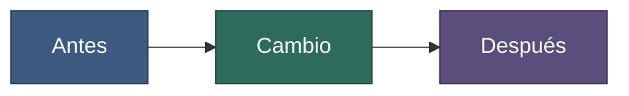

# Task N, subtask N — <!-- título del resultado -->

<!-- Plantilla de report. Guía: method/playbooks/write-report.md §1. Copia a work/reports/task-N-nombre/subtask-N-descripcion.md (o bug-N-nombre). Es para el desarrollador: claro, con tablas y diagramas. -->

**Fecha:** <!-- AAAA-MM-DD de redacción -->
**Rama / repos:** <!-- rama y alias de repos; estado de commits (nada commiteado / hash) -->
**Brief:** <!-- enlace al brief de la subtask -->

## Contenido

1. [Glosario](#1-glosario)
2. [Resumen](#2-resumen)
3. [Qué cambió](#3-qué-cambió)
4. [Verificación](#4-verificación)
5. [Decisiones y desviaciones](#5-decisiones-y-desviaciones)
6. [Impacto en docs](#6-impacto-en-docs)
7. [Siguiente paso](#7-siguiente-paso)
8. [Mensaje de commit sugerido](#8-mensaje-de-commit-sugerido)

## 1. Glosario

<!-- Incluir solo si la fila «Tecnologías que NO conozco» de DEV-PROFILE.md tiene alguna; si no, borra la sección y renumera. -->

| Término | Significado |
|---|---|
| <!-- término técnico --> | <!-- explicación en lenguaje sencillo, con analogía si ayuda --> |

## 2. Resumen

<!-- Qué se logró en pocas líneas y si se cumplieron los criterios de aceptación. -->



**Figura 1.** <!-- Epígrafe: qué muestra el diagrama y qué significa cada color. Describe los procesos punto por punto: 1. …, 2. …. Quita el diagrama si no aporta. -->

## 3. Qué cambió

<!-- Esta tabla es la fuente del changelog (method/playbooks/write-report.md §2): rellénala con rigor. -->

| Tipo | Archivo (con alias) | Cambio |
|---|---|---|
| <!-- Nuevo / Cambiado / Eliminado --> | <!-- @repo/ruta/archivo --> | <!-- qué y para qué --> |

## 4. Verificación

| Comprobación | Resultado | Evidencia |
|---|---|---|
| <!-- prueba, ejecución real, captura --> | <!-- pasa / falla / no ejecutada --> | <!-- salida, captura en work/reports/…/assets/ --> |

**No se pudo verificar:** <!-- lo omitido y por qué; o «nada» -->

## 5. Decisiones y desviaciones

| Tema | Decisión o desviación respecto al brief | Motivo |
|---|---|---|
| <!-- --> | <!-- marcar «decisión del agente» si no la tomó el desarrollador --> | <!-- --> |

**Preguntas abiertas:** <!-- para el desarrollador; con el valor por defecto usado -->

## 6. Impacto en docs

| Página de docs | Cambio |
|---|---|
| <!-- docs/área/página.md --> | <!-- actualizada / creada / sin cambios; o «ninguno» con el motivo --> |

**Hechos estables a promover a docs:** <!-- descubrimientos de este report que deben pasar a docs/ -->

## 7. Siguiente paso

<!-- Dónde se queda el trabajo para que la sesión siguiente se ubique: subtask siguiente, qué verificar primero, dependencias pendientes. -->

## 8. Mensaje de commit sugerido

<!-- Formato en COMANDOS.md §3. Atribución de IA: solo si la fila «Atribución de IA» de DEV-PROFILE.md la pide; por defecto ninguna. Multirepo: un mensaje por repo con el mismo ID de task. -->

```
tipo(ámbito): resumen breve [task-N]

- cambio 1
- cambio 2
```
