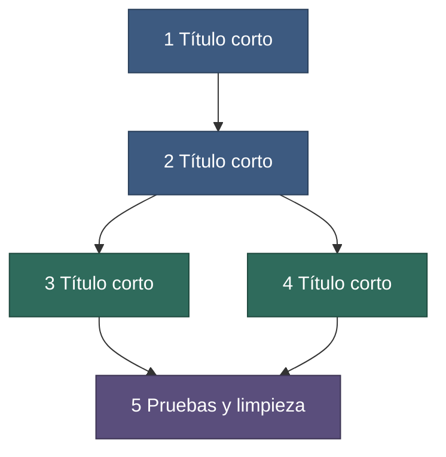

# Task N — <!-- resultado en una frase -->

<!-- Plantilla de README de task. Guía: method/playbooks/write-task.md §3. Copia a work/tasks/task-N-nombre/README.md y borra los comentarios. -->

**Fecha:** <!-- AAAA-MM-DD -->
**Estado:** <!-- borrador | en curso | hecha | pausada, con fecha y una línea de contexto -->
**Rama / repos:** <!-- rama de trabajo y alias de repos afectados, p. ej. @back, @front -->
**Origen:** <!-- solicitud, feedback o bug que la motiva; enlace a la fuente -->
**Tasks relacionadas:** <!-- enlaces a tasks previas de las que depende, o «ninguna» -->

## Contenido

1. [Objetivo](#1-objetivo)
2. [Decisiones y restricciones](#2-decisiones-y-restricciones)
3. [Plan y dependencias](#3-plan-y-dependencias)
4. [Índice de subtasks](#4-índice-de-subtasks)
5. [Qué necesita del desarrollador](#5-qué-necesita-del-desarrollador)
6. [Backlog (no redactado)](#6-backlog-no-redactado)
7. [Entregables compartidos](#7-entregables-compartidos)

## 1. Objetivo

<!-- Qué entrega la task completa y por qué. Qué cambia para el usuario. Qué problema o necesidad la origina. Distingue estado actual y estado futuro. -->

## 2. Decisiones y restricciones

Decisiones de esta task: [decisions.md](./decisions.md) (IDs `T<N>-…`). Decisiones de todo el proyecto: `../../../docs/decisions/`.

Restricciones globales. Las del proyecto están en `PROJECT.md` §3 (`C1…`); aquí solo las propias de la task y las críticas repetidas.

| ID | Restricción | Origen |
|---|---|---|
| T<N>-C1 | <!-- restricción propia de esta task --> | <!-- decisión o desarrollador --> |

<!-- Cada brief repite en una línea las restricciones críticas; no copies esta tabla entera en ellos. -->

## 3. Plan y dependencias

<!-- Elimina el diagrama si la task tiene una sola subtask. -->

**Figura 1.** Dependencias entre subtasks. Azul: marco. Verde: funcionalidad. Morado: endurecimiento. <!-- Describe punto por punto qué muestra el diagrama y qué subtasks pueden correr en paralelo. -->

1. <!-- Qué hace la subtask 1 y qué se puede demostrar al terminarla. -->
2. <!-- Subtasks que pueden correr en paralelo solo si no editan los mismos archivos. -->

## 4. Índice de subtasks

Esfuerzo: S horas · M un día · L varios días. Estado: `pendiente` · `en curso` · `hecha` (sin commit) · `hecha (commit <hash>)`. **El agente actualiza la columna Estado al cerrar cada subtask** y refleja el resumen en `INDEX.md`.

| # | Subtask | Tipo | Resultado | Esfuerzo | Modelo sugerido | Depende de | Estado |
|---|---|---|---|---|---|---|---|
| 1 | [subtask-1-descripcion](./subtask-1-descripcion.md) | <!-- marco / funcionalidad / endurecimiento / investigación --> | <!-- resultado observable --> | <!-- S/M/L --> | <!-- opcional --> | — | pendiente |

## 5. Qué necesita del desarrollador

| Ítem | Necesario para | Valor por defecto del agente mientras tanto |
|---|---|---|
| <!-- decisión o dato que solo el desarrollador puede dar --> | <!-- subtask --> | <!-- valor que el agente usa y deja marcado como decisión del agente --> |

## 6. Backlog (no redactado)

| Ítem | Nota |
|---|---|
| <!-- cosa fuera de alcance que no se redacta como subtask --> | <!-- por qué queda fuera --> |

## 7. Entregables compartidos

- Un report por subtask en `work/reports/task-N-nombre/subtask-N-descripcion.md`.
- Docs técnicos actualizados en `docs/` en la misma subtask que cambia el comportamiento.
- Changelog en `work/changelogs/task-N-nombre/` por cada subtask que cambia código funcional.
- Al cerrar la task: informe de PR ([method/templates/pr.md](./pr.md)) y actualización de `INDEX.md`.
