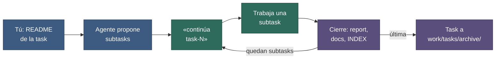

# Quickstart — 5 minutos

**Fecha:** 27 de octubre de 2026 · Detalle completo en el [índice de docs](./README.md).

## 1. Instalar

Elige un modo. **A:** `dev/` dentro de tu repo. **B:** `dev/` junto a varios repos (front y back, por ejemplo). Requisitos: Python 3.10+ y git.

**Vía agente (recomendada).** Desde la carpeta de tu proyecto instala las skills (`dev-setup`, `dev-update` y `dev-feedback`):

```bash
npx skills add TomasCDG/dev-guidelines
```

Abre una sesión nueva del agente en esa carpeta y dile:

> instala dev-guidelines en este proyecto

**Vía comando.** Clona el paquete fuera de tu proyecto, entra en tu proyecto y ejecuta el instalador desde ahí:

```bash
git clone https://github.com/TomasCDG/dev-guidelines.git
cd ruta/a/mi-repo
python ../dev-guidelines/scripts/install.py --mode A --adapters claude
```

Ajusta la ruta de `install.py` a donde clonaste. Es el modo A; para el modo B, ejecútalo desde la carpeta que contiene los repos con `--mode B --git-init`. Si `python` no existe, prueba `python3` o `py`.

Resultado: carpeta `dev/` y un `AGENTS.md` en la raíz que apunta a ella. Lo generado queda fuera de git. Detalle de pasos, opciones, modos y adaptadores: [01-instalacion.md](./01-instalacion.md). Para actualizar más adelante, dile al agente «actualiza dev-guidelines» ([01-instalacion.md §10](./01-instalacion.md#10-actualizar-a-una-versión-nueva)).

## 2. Configurar (pocas líneas)

| Archivo | Quién lo usa | Qué poner | Versionado |
|---|---|---|---|
| `dev/PROJECT.md` (se lee siempre) | Todo el equipo | Repos con alias (`@main`, o `@front` y `@back`), idiomas, restricciones, zonas intocables | Sí |
| `dev/COMANDOS.md` (bajo demanda) | Todo el equipo | Stacks, comandos de test y run, política de commits; se rellena solo con lo que se encuentra | Sí |
| `dev/DEV-PROFILE.md` (opcional) | Solo tú | Tecnologías que no conoces, idioma del chat, formato de la respuesta final, atribución de IA | No |

No hay campos obligatorios ni avisos por campos vacíos (`—` = sin definir): cuando el agente necesita un dato, te lo pregunta una vez, propone un valor y lo anota.

## 3. Verificar

El instalador ya ejecuta `check.py` al terminar: `0 errores` es lo esperado (también 0 avisos). Para repetirlo: `python -I dev/.tools/check.py dev`. Más adelante, pide al agente «diagnostica dev/».

## 4. Trabajar

Abre tu herramienta de agente en el repo (o en la carpeta que contiene los repos, en modo B) y escribe:

| Quieres | Escribe |
|---|---|
| Crear una task | «Crea la task `<nombre>`. Lee mi descripción en `dev/work/tasks/<carpeta>/README.md`, propón subtasks y valídalas conmigo.» |
| Retomar | «continúa task-1» |
| Siguiente subtask | «siguiente» |
| Una subtask concreta | «subtask 3 de task-1» |
| Arreglar un bug | «bug-1» |
| Actualizar el método | «actualiza dev-guidelines» |

El agente lee solo lo necesario, verifica el repo, trabaja la subtask y al cerrar deja: report, docs actualizados, changelog (si tocó código), estado en `INDEX.md` y un mensaje de commit sugerido. Al cerrar una task anota una retro en `dev/RETRO.md`; cuando haya varias, pide «feedback del método» ([03-uso.md §16](./03-uso.md#16-feedback-del-método)).

## 5. El ciclo, en una imagen



**Figura 1.** Azul: planificación contigo. Verde: sesión de trabajo. Morado: cierre y archivo. Cada vuelta usa una sesión nueva; el estado vive en `INDEX.md` y en el README de la task, no en la memoria del agente.

## 6. Si algo falla

| Síntoma | Qué hacer |
|---|---|
| `check.py` da errores | Lee el mensaje: indica archivo y línea. Un `TODO` literal en `PROJECT.md` o `COMANDOS.md` es aviso: cámbialo por `—`. |
| El agente no sabe por dónde seguir | Revisa «Activo ahora» en `dev/INDEX.md`. |
| Una skill no se activa | No importa: `dev/AGENTS.md` nombra el playbook equivalente en `dev/method/playbooks/`. |
| No sabes si `dev/` está sano | Dile al agente «diagnostica dev/»: ejecuta `check.py`, revisa lo que el script no ve y te propone arreglos. |

Errores del instalador: [01-instalacion.md §12](./01-instalacion.md#12-solución-de-problemas). Para más: [instalación](./01-instalacion.md) · [configuración](./02-configuracion.md) · [uso](./03-uso.md) · [referencia](./04-referencia.md).
