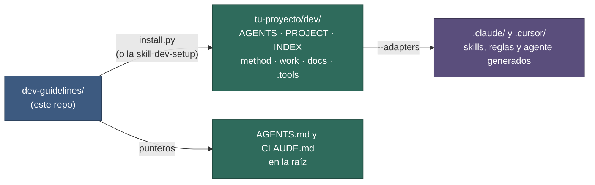
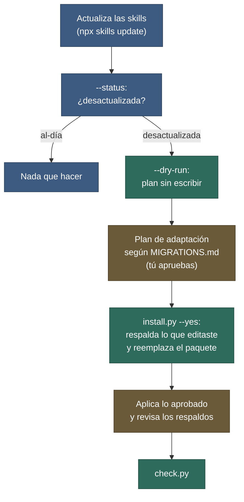

# Instalación

**Fecha:** 27 de octubre de 2026 · **Versión del paquete:** 0.7.0

Para una instalación en 5 minutos, ver [00-quickstart.md](./00-quickstart.md); aquí está el detalle.

## Contenido

1. [Qué vas a obtener](#1-qué-vas-a-obtener)
2. [Requisitos](#2-requisitos)
3. [Elegir el modo: A o B](#3-elegir-el-modo-a-o-b)
4. [Vía skill dev-setup (recomendada)](#4-vía-skill-dev-setup-recomendada)
5. [Vía install.py](#5-vía-installpy)
6. [Referencia de opciones](#6-referencia-de-opciones)
7. [Adaptadores para Claude Code y Cursor](#7-adaptadores-para-claude-code-y-cursor)
8. [Qué hace y qué no hace el instalador](#8-qué-hace-y-qué-no-hace-el-instalador)
9. [Git: qué se versiona y qué no](#9-git-qué-se-versiona-y-qué-no)
10. [Actualizar a una versión nueva](#10-actualizar-a-una-versión-nueva)
11. [Desinstalar](#11-desinstalar)
12. [Solución de problemas](#12-solución-de-problemas)
13. [Mantener el paquete: publicar una versión](#13-mantener-el-paquete-publicar-una-versión)
14. [Siguiente paso](#14-siguiente-paso)

## 1. Qué vas a obtener

Una carpeta `dev/` dentro de tu proyecto, copiada desde [`dev-template/`](../dev-template/), más dos archivos de apunte en la raíz (`AGENTS.md` y `CLAUDE.md`) que le dicen al agente que empiece por `dev/AGENTS.md`. Dentro de `dev/.tools/` queda una copia de `check.py` para verificar y diagnosticar sin necesitar el paquete. Opcionalmente, skills, reglas y el agente `dev-doctor` generados para Claude Code o Cursor.



**Figura 1.** Qué instala `install.py`. Azul: el paquete de origen. Verde: lo que siempre queda en tu proyecto. Morado: adaptadores opcionales. Pasos: (1) el script copia `dev-template/` como `dev/` (y, si ya existía, respalda antes lo que editaste) y `check.py` como `dev/.tools/check.py`; (2) crea los punteros en la raíz; (3) si lo pides, genera las skills, reglas y el agente a partir de los playbooks ya copiados; (4) escribe `.package-version` y `.package-manifest`; (5) ejecuta `check.py`.

## 2. Requisitos

| Requisito | Para qué | Obligatorio |
|---|---|---|
| Python 3.10 o superior | `install.py`, `check.py`, adaptadores y hook. Solo usa la biblioteca estándar | Sí |
| Git | Excluir lo generado del repo (modo A) o crear el repo de `dev/` (modo B) | Recomendado |

El mismo comando sirve en Linux, macOS, Windows y WSL. En algunos sistemas el intérprete se llama `python3` o `py`: usa el que funcione.

## 3. Elegir el modo: A o B

| | **A. Dentro del repo** | **B. Junto a varios repos** |
|---|---|---|
| Estructura | `repo/dev/` | `workspace/dev/` + `workspace/front/` + `workspace/back/` |
| Cuándo | Un solo repo | Un proyecto repartido en varios repos |
| Quién versiona `dev/` | Nadie: exclusión local en `.git/info/exclude` | `dev/` es su propio repo git |
| Raíz de trabajo del agente | La raíz del repo | La raíz del workspace |
| Apuntes `AGENTS.md` / `CLAUDE.md` | En la raíz del repo | En la raíz del workspace |
| Perfil personal (`DEV-PROFILE.md`) | Excluido junto con `dev/` | Listado en `dev/.gitignore` |

Si dudas: un repo → A; front y back en carpetas separadas → B.

## 4. Vía skill dev-setup (recomendada)

La skill [`skills/dev-setup/`](../skills/dev-setup/SKILL.md) sigue el formato Agent Skills y lleva el instalador dentro (`scripts/install.py` y `assets/`). Es la vía más cómoda: el agente decide los parámetros, configura lo que el script no puede saber y verifica.

1. **Instala la skill** en tu proyecto o en tu usuario:
   - `npx skills add TomasCDG/dev-guidelines` (instala las tres skills: `dev-setup`, `dev-update` y `dev-feedback`), o
   - copia las carpetas de `skills/` (`dev-setup` es imprescindible; las otras dos son opcionales pero recomendadas) a `.claude/skills/` (proyecto) o a `~/.claude/skills/` (personal).
2. **Pídelo** en una sesión nueva del agente, en la carpeta del proyecto: «instala dev-guidelines en este proyecto».
3. **El agente detecta el modo.** Un repo git sin otros repos dentro → A; dos o más repos en la carpeta → B; un `dev/` con `.package-version` → actualización.
4. **Te hace una sola pregunta** con lo propuesto: modo y carpeta, adaptadores (`claude` por defecto; `cursor` si existe `.cursor/`) y, en modo B, si ejecuta `git init` en `dev/`.
5. **Ejecuta `scripts/install.py`.** Nunca copia archivos a mano. Si la salida termina con errores, se detiene y los corrige.
6. **Propone `PROJECT.md` (núcleo) y `COMANDOS.md`** inspeccionando tus repos (`package.json`, `pyproject.toml`, `git log`…) y espera tu aprobación antes de escribir. Lo que no encuentra queda en `—`; solo te pregunta si hay algo que el agente no deba hacer ni tocar.
7. **Para `DEV-PROFILE.md`** te hace como mucho una pregunta corta y opcional (puedes saltarla).
8. **Ejecuta `check.py` y resume** el resultado: qué se instaló, qué falta y los siguientes pasos.

## 5. Vía install.py

Primero descarga el paquete fuera de tu proyecto:

```bash
git clone https://github.com/TomasCDG/dev-guidelines.git
```

Después, modo A, ejecutando desde la carpeta de tu proyecto (`--target` vale por defecto la carpeta actual):

```bash
cd ruta/a/mi-repo
python ../dev-guidelines/scripts/install.py --mode A
```

Con adaptadores de Claude Code y Cursor, y sin preguntas:

```bash
python ../dev-guidelines/scripts/install.py --mode A --adapters claude,cursor --yes
```

También puedes ejecutarlo desde la carpeta del paquete y dar el destino con `--target /ruta/a/mi-repo`. `-I` (modo aislado de Python) es opcional; se usa en los ejemplos de más abajo.

Resultado esperado en `mi-repo/`:

| Ruta | Qué es |
|---|---|
| `dev/` | La carpeta del método (excluida de git). |
| `dev/.tools/check.py` | Copia del verificador, para usarlo sin el paquete. |
| `AGENTS.md` | Apunte a `dev/AGENTS.md`. |
| `CLAUDE.md` | Contiene `@AGENTS.md`. |
| `.claude/skills/dev-*/`, `.claude/rules/dev-*.md`, `.claude/agents/dev-doctor.md` | Solo con `--adapters claude`. |
| `.cursor/rules/dev-*.mdc` | Solo con `--adapters cursor`. |
| `dev/.package-version` | Versión, fecha, modo y adaptadores instalados (`version`, `installed`, `mode`, `adapters`; en una actualización, también `previous`). |
| `dev/.package-manifest` | Hash sha256 de cada archivo del paquete instalado (`sha256  ruta`); sirve para detectar lo que editaste a mano. |
| `dev/RETRO.md` | Tabla de retros del proyecto; solo se crea si falta ([02-configuracion.md §11](./02-configuracion.md#13-retromd-retros-del-proyecto)). |
| `dev/.backup/` | Solo tras una actualización en la que habías editado archivos del paquete: copia de esos archivos (§10). |

Si `AGENTS.md` o `CLAUDE.md` ya existían, el script pregunta antes de **añadir al final** una referencia a `dev/AGENTS.md`; no toca el resto del archivo. Al terminar ejecuta `check.py` sobre `dev/` e imprime el resultado.

### Modo B

Estructura previa:

```
workspace/
├── front/
└── back/
```

```bash
python -I scripts/install.py --mode B --target /ruta/a/workspace --git-init
```

Resultado:

```
workspace/
├── AGENTS.md          apunte
├── CLAUDE.md          @AGENTS.md
├── front/
├── back/
└── dev/               repo git propio (con --git-init)
    ├── .gitignore     contiene DEV-PROFILE.md
    ├── .tools/
    └── ...
```

Después, en `dev/PROJECT.md` §1 elimina el alias `@main` y declara uno por repo (`@front` → `../front`, `@back` → `../back`). Detalle en [02-configuracion.md](./02-configuracion.md#3-repos-y-alias-projectmd-1). Trabaja siempre abriendo el agente en la raíz del `workspace/`.

## 6. Referencia de opciones

```bash
python -I scripts/install.py --mode A|B --target DIR [--yes] [--git-init] [--adapters claude,cursor]
python -I scripts/install.py --status --target DIR
python -I scripts/install.py --dry-run --target DIR [--mode A|B]
```

| Opción | Efecto | Por defecto |
|---|---|---|
| `--mode A\|B` | Modo de instalación. Si se omite y hay terminal, el script pregunta; sin terminal falla (código 2). | Pregunta |
| `--target DIR` | Raíz del repo (A) o del workspace (B). Debe existir. | Directorio actual |
| `--yes` | Confirma todo sin preguntar, incluida la actualización de una instalación existente y la sobrescritura de adaptadores sin marca. | Pregunta |
| `--git-init` | Modo B: ejecuta `git init` en `dev/` si aún no es un repo. | No |
| `--adapters LISTA` | `claude`, `cursor` o `claude,cursor`. En una actualización se regeneran los ya instalados. | Ninguno |
| `--dry-run` | No escribe nada: imprime el plan (versión instalada → nueva; archivos del paquete nuevos, cambiados y sin cambios; los que editaste y se respaldarían; archivos de usuario que faltan; adaptadores que se regenerarían). | No |
| `--status` | Imprime una línea `instalada=X nueva=Y estado=al-día\|desactualizada\|sin-instalar` y termina con código 0. | No |
| `-h`, `--help` | Muestra el uso. | — |

Códigos de salida: `0` correcto (o cancelado por ti); `1` la verificación final da errores; `2` uso incorrecto (modo o destino inválido, o falta `--mode` sin terminal).

En scripts o agentes, sin terminal interactiva: pasa siempre `--mode`, y `--yes` si quieres actualizar una instalación existente. Sin entrada interactiva, cualquier pregunta se contesta «no».

## 7. Adaptadores para Claude Code y Cursor

El método funciona **sin** adaptadores: `AGENTS.md` y el catálogo de `INDEX.md` indican qué playbook leer. Los adaptadores añaden activación nativa en cada herramienta, sin copiar contenido: cada uno lleva la descripción del playbook y manda leer el archivo original.

| Adaptador | Qué genera | Efecto |
|---|---|---|
| `claude` | `.claude/skills/dev-<nombre>/SKILL.md` (10) | Skills que se activan por su descripción. |
| `claude` | `.claude/rules/dev-*.md` con `paths:` (5) | Cargan el playbook al tocar `dev/docs/**`, `dev/work/bugs/**`, `dev/work/tasks/**`, `dev/work/reports/**` y `dev/work/changelogs/**`, o `dev/docs/decisions/**`. |
| `claude` | `.claude/agents/dev-doctor.md` | Agente de solo lectura (Read, Grep, Glob, Bash) que diagnostica `dev/` con el playbook `diagnose` ([03-uso.md §15](./03-uso.md#15-diagnóstico-de-salud)). |
| `claude` | `dev/.adapters/session-start.py` y `settings-snippet.json` | Hook opcional; **no se activa solo** ([02-configuracion.md §10](./02-configuracion.md#10-hook-sessionstart-opcional)). |
| `cursor` | `.cursor/rules/dev-agents.mdc` (siempre activa) y una regla por playbook | Reglas «Apply Intelligently» por descripción. |

Reglas de la generación:

- Cada archivo generado lleva la marca `dev-guidelines:generated`. Los que **no** la llevan son tuyos: se omiten (y lo avisa) salvo que uses `--yes`.
- Es idempotente: una segunda ejecución reescribe solo lo que cambió y elimina los adaptadores de playbooks que ya no existen.
- Se puede ejecutar sola, sin reinstalar:

```bash
python -I scripts/adapters/generate.py --target /ruta/a/mi-repo --adapters claude,cursor
```

Los archivos generados no deben editarse a mano: se pierden al regenerar. Para cambiar su contenido, edita el playbook y regenera.

## 8. Qué hace y qué no hace el instalador

| Hace | No hace |
|---|---|
| Copia `AGENTS.md`, `method/` (playbooks, stacks y plantillas) y `.tools/check.py` (archivos del paquete). | Rellenar `PROJECT.md`, `COMANDOS.md` ni `DEV-PROFILE.md`: quedan con `—` (lo hace la skill `dev-setup` contigo). |
| Crea `PROJECT.md`, `COMANDOS.md`, `DEV-PROFILE.md`, `INDEX.md`, `docs/`, `work/tasks/`, `work/bugs/`, `work/reports/`, `work/changelogs/`, `docs/decisions/` y `RETRO.md` **solo si faltan**. | Sobrescribir tus datos en una actualización. |
| Crea o completa `AGENTS.md` y `CLAUDE.md` de la raíz, con confirmación si ya existían. | Modificar tu configuración de Claude Code (`settings.json`). |
| Genera los adaptadores pedidos con `--adapters`. | Hacer commits ni `git add`. |
| Añade exclusiones a `.git/info/exclude` (ver §9) o crea `dev/.gitignore` (B). | Instalar dependencias: no hay ninguna. |
| Escribe `dev/.package-version` y `dev/.package-manifest`, y ejecuta `check.py` al final. | |
| Antes de reemplazar, respalda en `dev/.backup/` los archivos del paquete que editaste. | |

## 9. Git: qué se versiona y qué no

| Archivo o carpeta | Modo A | Modo B |
|---|---|---|
| `dev/` | No (exclusión local) | Sí, en su propio repo |
| `dev/DEV-PROFILE.md` | No (exclusión local) | No (`dev/.gitignore`) |
| `dev/.backup/` | No (exclusión local `dev/.backup/`) | No (`dev/.gitignore`) |
| `dev/.feedback/` (lo crea `dev-feedback`) | No (exclusión local `dev/.feedback/`) | No (`dev/.gitignore`) |
| `AGENTS.md`, `CLAUDE.md` de la raíz | No: se excluyen **solo los que creó el instalador** | Si la raíz del workspace es un repo git, se excluyen los que creó el instalador; si no, no hay nada que excluir |
| `.claude/skills/dev-*`, `.claude/rules/dev-*.md`, `.claude/agents/dev-*.md`, `.cursor/rules/dev-*.mdc` | No (excluidos) | Excluidos si la raíz del workspace es un repo git |

Las exclusiones van a `.git/info/exclude` (local, no se comparte), nunca a `.gitignore`. Un puntero que ya existía en tu repo no se excluye: es tuyo. En el modo A, `dev/` no se comparte: si versionas un `AGENTS.md` o `CLAUDE.md` propio, tus compañeros verán un apunte a una carpeta que no tienen; acuerda con el equipo cómo compartir `dev/`.

## 10. Actualizar a una versión nueva

La vía recomendada es la skill [`dev-update`](../skills/dev-update/SKILL.md), hermana de `dev-setup`: comprueba la versión, te enseña el plan, adapta los archivos de tu proyecto que el instalador no toca (guiada por [MIGRATIONS.md](../release/MIGRATIONS.md)), actualiza y verifica. Pídelo con una frase: «actualiza dev-guidelines».



**Figura 2.** Actualización con `dev-update`. Azul: comprobaciones. Verde: pasos del instalador. Ámbar: decisiones y ediciones tuyas o del agente con tu aprobación. Pasos: (1) actualiza las skills; (2) `--status` dice si hace falta; (3) `--dry-run` muestra qué cambiaría; (4) el agente propone las adaptaciones de tus archivos y esperas su aprobación; (5) el instalador respalda lo que editaste y reemplaza los archivos del paquete; (6) se aplican las adaptaciones y se revisan los respaldos; (7) `check.py` verifica.

### Con la skill

1. Actualiza las skills a la versión nueva: `npx skills update` (o vuelve a copiar `skills/dev-setup`, `skills/dev-update` y `skills/dev-feedback`). `dev-update` usa el instalador y `MIGRATIONS.md` de `dev-setup`, así que ambas deben estar.
2. Di «actualiza dev-guidelines». El agente sigue estos pasos:
   1. `--status`: si es `al-día` o `sin-instalar`, para.
   2. `--dry-run`: te resume la versión, qué cambia y qué archivos tuyos se respaldarán.
   3. Lee de `MIGRATIONS.md` solo las versiones entre la tuya (exclusiva) y la nueva, comprueba qué filas aplican a tu proyecto y te muestra el plan. Las de riesgo bajo van en una sola pregunta; las de riesgo medio o alto, de una en una.
   4. Si `MIGRATIONS.md` pide mover carpetas (de 0.5.0 a 0.6.0): ejecuta `migrate.py --target dev --dry-run`, te muestra los movimientos y enlaces, espera tu aprobación y ejecuta `migrate.py`.
   5. Ejecuta `install.py --mode <el de .package-version> --yes` (sin `--adapters`: conserva los instalados). Con la estructura antigua sin migrar, `install.py` avisa y no reemplaza nada.
   6. Aplica las adaptaciones restantes que aprobaste.
   7. Si hay respaldos, los compara con los archivos nuevos y, si tu edición era sustancial, te propone dónde conservarla (por ejemplo `PROJECT.md` §3 o §4).
   8. Ejecuta `check.py` y cierra con versión anterior → nueva, lo adaptado y lo pendiente.

### Con el comando

Desde la raíz del paquete actualizado (`git pull`). Con la skill, usa `<ruta de dev-setup>/scripts/install.py` y `<ruta de dev-setup>/scripts/migrate.py`:

```bash
python -I scripts/install.py --status  --target /ruta/a/mi-repo     # instalada=0.4.0 nueva=0.5.0 estado=desactualizada
python -I scripts/install.py --dry-run --target /ruta/a/mi-repo     # plan, sin escribir nada
python -I scripts/migrate.py --target /ruta/a/mi-repo/dev --dry-run   # solo 0.5.0 -> 0.6.0: movimientos y enlaces, sin escribir
python -I scripts/migrate.py --target /ruta/a/mi-repo/dev             # solo 0.5.0 -> 0.6.0: mueve carpetas y reescribe enlaces
python -I scripts/install.py --mode A  --target /ruta/a/mi-repo --yes
```

Usa el mismo destino y modo de la instalación. Con `--yes` no pregunta; **sin terminal es obligatorio**. No hace falta repetir `--adapters`: los recuerda `dev/.package-version`. Después, comprueba con `python -I dev/.tools/check.py dev` o pide «diagnostica dev/». Los cambios de cada versión están en [CHANGELOG.md](../release/CHANGELOG.md); lo que hay que adaptar a mano en tus archivos, en [MIGRATIONS.md](../release/MIGRATIONS.md).

### Qué se reemplaza y qué se conserva

| Se reemplaza | Se conserva |
|---|---|
| `AGENTS.md`, `method/`, `.tools/check.py` | `PROJECT.md`, `COMANDOS.md`, `DEV-PROFILE.md`, `INDEX.md`, `RETRO.md`, `docs/`, `work/tasks/`, `work/bugs/`, `work/reports/`, `work/changelogs/`, `docs/decisions/` |

Los archivos de usuario solo se crean si faltan. El instalador **no** adapta el contenido de `INDEX.md`, `PROJECT.md` y similares a un formato nuevo: de eso se encarga `dev-update` con `MIGRATIONS.md`. Pasar a 0.6.0 exige antes `migrate.py` (mueve `tasks/`, `bugs/`, `reports/`, `changelogs/` a `work/`, `decisions/` a `docs/decisions/` y `guidelines/` y `templates/` a `method/`, y reescribe los enlaces; con repo git en `dev/` usa `git mv`; deja copia en `dev/.backup/<fecha>-migracion-0.6.0/`). Pasar a 0.5.0 exigió esa migración (crear `COMANDOS.md` con las antiguas secciones 4, 5 y 8 de `PROJECT.md`, y reducir `PROJECT.md` y `DEV-PROFILE.md`): `dev-update` muestra el antes/después de cada archivo, espera tu aprobación y guarda una copia en `dev/.backup/`.

### Respaldos y manifiesto

- Al instalar o actualizar, el instalador escribe `dev/.package-manifest` con el hash sha256 de cada archivo del paquete (`AGENTS.md`, `method/**`, `.tools/check.py`; rutas relativas a `dev/`).
- Antes de reemplazar, compara cada archivo del paquete con el manifiesto anterior. Si no coincide (lo editaste), o no hay manifiesto previo y difiere del nuevo, lo copia a `dev/.backup/<AAAA-MM-DD>-v<versión previa>/<ruta>` y lo lista en la salida. Los idénticos no se copian. Si un archivo que tú añadiste dentro de `method/` ya no existe en el paquete, también se respalda antes de borrarlo.
- `dev/.backup/` está excluido de git (modo A: `.git/info/exclude`; modo B: `dev/.gitignore`) y `check.py` lo ignora. Cuando ya no lo necesites, bórralo.
- Una instalación de 0.3.0 no tiene manifiesto: la primera actualización trata como editado todo archivo del paquete que difiera del nuevo y lo respalda. Es más cauto de lo necesario, no pierde nada.
- Para que un cambio tuyo sobreviva a las actualizaciones, no edites los archivos del paquete: pon las reglas del proyecto en `PROJECT.md` §3 y §4, o llévalas al paquete.

**Venir de 0.2.0 o anterior:** los scripts de instalación en Bash y PowerShell ya no existen; usa `install.py` o la skill. Tu `dev/` actual se actualiza igual (gana `dev/.tools/check.py`, el playbook `diagnose` y el agente `dev-doctor`); `MIGRATIONS.md` dice qué adaptar.

## 11. Desinstalar

El instalador no incluye desinstalador. Borra a mano, según lo que hayas instalado:

| Qué | Cómo |
|---|---|
| La carpeta del método | Borra `dev/`. **Contiene tus tasks, reports y docs**: guarda lo que quieras conservar. |
| Apuntes de la raíz | Borra `AGENTS.md` y `CLAUDE.md` si los creó el instalador; si ya existían, quita solo el bloque añadido al final (empieza tras una línea `---`). |
| Adaptadores de Claude Code | Borra `.claude/skills/dev-*/`, `.claude/rules/dev-*.md` y `.claude/agents/dev-doctor.md`. |
| Adaptadores de Cursor | Borra `.cursor/rules/dev-*.mdc`. |
| Skill de instalación | Borra `.claude/skills/dev-setup/` (o la de `~/.claude/skills/`). |
| Hook | Quita de tu `settings.json` el bloque `SessionStart` que añadiste. |
| Exclusiones de git | Borra las líneas que añadió el instalador a `.git/info/exclude` (`dev/`, `dev/DEV-PROFILE.md`, `dev/.backup/`, `dev/.feedback/`, los punteros y los adaptadores). |
| Repo de `dev/` (modo B) | Se va con la carpeta `dev/`. |

## 12. Solución de problemas

| Síntoma | Causa probable | Qué hacer |
|---|---|---|
| `Falta --mode A\|B y no hay terminal para preguntarlo.` (código 2) | Ejecutado desde un script o agente, sin terminal | Pasa `--mode A` o `--mode B`. |
| `Modo inválido: 'x' (usa A o B)` | `--mode` mal escrito | Usa `A` o `B`. |
| `No existe el directorio destino` | `--target` apunta a una carpeta que no existe | Créala o corrige la ruta. |
| `Cancelado. No se modificó nada` al actualizar | No confirmaste, o no hay terminal para preguntar: actualizar sin terminal exige `--yes` | Repite con `--yes`. |
| `python` no se encuentra, o el acceso directo no ejecuta nada | Python no instalado o shim roto (pyenv, tienda de Windows) | Instala Python 3.10+ o prueba `python3` / `py`. |
| `Adaptadores inválidos` | Valor distinto de `claude` o `cursor` en `--adapters` | Usa `claude`, `cursor` o `claude,cursor`. |
| `omitido (existe sin marca; usa --yes para sobrescribir)` | Hay un archivo tuyo con el mismo nombre que un adaptador | Renómbralo o usa `--yes` si quieres reemplazarlo. |
| `no es la raíz de un repo git` (modo A) | No existe `.git` en el destino | Ejecuta `git init` antes; sin repo no se añade la exclusión local. |
| Termina con `errores` distintos de 0 | `check.py` encontró un problema en `dev/` | Lee el mensaje (indica archivo); pide «diagnostica dev/». |
| `Falta el archivo de versión …` o `Paquete incompleto: no se encuentran dev-template/…` | Paquete o skill incompletos (se copió sin `release/VERSION`, `dev-template/`, `scripts/adapters/` o `scripts/check.py`; el mensaje lista lo que falta) | Vuelve a descargar el paquete o actualiza la skill. |
| Tras actualizar hay una carpeta `dev/.backup/` | Habías editado archivos del paquete y se respaldaron | Revísala y lleva lo útil a `PROJECT.md`; luego puedes borrarla (§10). |
| Las skills no aparecen en Claude Code | La sesión se abrió antes de generarlas | Abre una sesión nueva. |
| `git status` muestra los punteros o los adaptadores como nuevos | Ya existían antes de instalar, o el workspace (modo B) no es un repo | Ver §9; añade las líneas a `.git/info/exclude` si lo quieres. |

## 13. Mantener el paquete: publicar una versión

Solo para quien modifica el paquete. Los archivos de `skills/dev-setup/scripts/` y `skills/dev-setup/assets/` son una **copia generada**; las fuentes son `release/VERSION`, `release/MIGRATIONS.md`, `dev-template/`, `scripts/adapters/`, `scripts/check.py`, `scripts/install.py` y `scripts/migrate.py`. No se editan a mano. La versión del paquete vive solo en `release/VERSION`: el instalador la lee de ahí (o de `assets/VERSION` en la skill) y `scripts/build-skill.py` la copia a la skill y la escribe en `metadata.version` de `dev-setup`, `dev-update` y `dev-feedback`.

Para publicar una versión nueva:

1. Sube `release/VERSION` (por ejemplo `0.7.0` → `0.8.0`; solo el número, `X.Y.Z`).
2. Añade una entrada arriba de [release/CHANGELOG.md](../release/CHANGELOG.md) con la fecha, qué se añade, cambia y corrige.
3. Añade una sección `## X.Y.Z` arriba de [release/MIGRATIONS.md](../release/MIGRATIONS.md): archivos del paquete que se reemplazan, tabla de cambios en archivos del proyecto (archivo, cambio, acción propuesta, riesgo bajo/medio/alto) y compatibilidad. Es lo que lee `dev-update`; si un cambio no obliga a tocar nada del proyecto, dilo igualmente.
4. Actualiza el número de versión de los encabezados de `docs/*.md`.
5. Regenera la skill y comprueba:

```bash
python -I scripts/build-skill.py           # copia release/VERSION, release/MIGRATIONS.md, dev-template/, scripts/adapters/, scripts/check.py, scripts/install.py y scripts/migrate.py; escribe metadata.version
python -I scripts/build-skill.py --check   # solo comprueba que está al día (código 1 si no)
```

6. Prueba una instalación limpia y una actualización desde la versión anterior (`--status`, `--dry-run`, `--yes`) en carpetas de prueba, y ejecuta `python -I scripts/check.py` sobre el resultado.

`--check` falla si falta una copia, si sobra algo en `assets/` o si `metadata.version` de las skills no coincide con `release/VERSION`. Hazlo antes de publicar el paquete.

## 14. Siguiente paso

Revisa `dev/PROJECT.md`, `dev/COMANDOS.md` y, si quieres, `dev/DEV-PROFILE.md` siguiendo [02-configuracion.md](./02-configuracion.md) (si usaste la skill, el agente ya lo propuso contigo).
