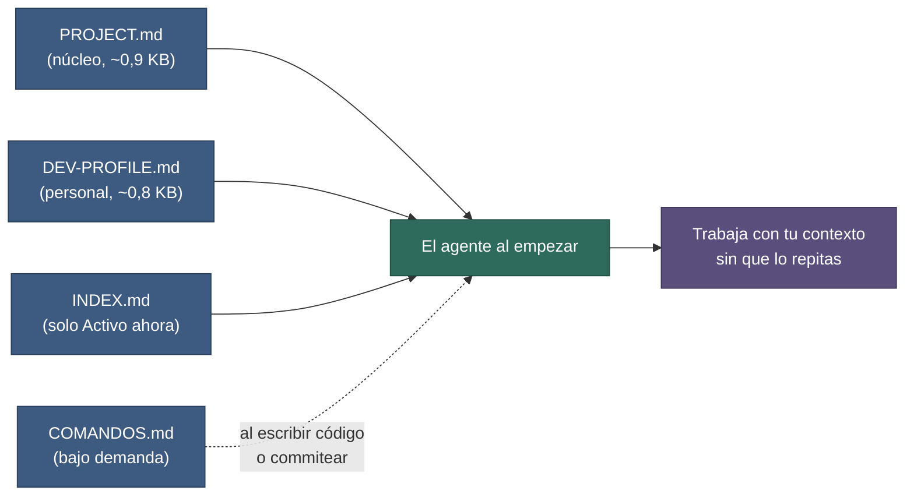

# Configuración

**Fecha:** 27 de octubre de 2026 · **Versión del paquete:** 0.7.0

## Contenido

1. [Qué se configura y dónde](#1-qué-se-configura-y-dónde)
2. [PROJECT.md: el núcleo](#2-projectmd-el-núcleo)
3. [Repos y alias (PROJECT.md §1)](#3-repos-y-alias-projectmd-1)
4. [COMANDOS.md: stacks, comandos y commits](#4-comandosmd-stacks-comandos-y-commits)
5. [DEV-PROFILE.md: preferencias personales](#5-dev-profilemd-preferencias-personales)
6. [Qué se lee siempre y qué bajo demanda](#6-qué-se-lee-siempre-y-qué-bajo-demanda)
7. [Stacks](#7-stacks)
8. [Política de commits](#8-política-de-commits)
9. [Skills y reglas](#9-skills-y-reglas)
10. [Hook SessionStart (opcional)](#10-hook-sessionstart-opcional)
11. [Verificar con check.py](#11-verificar-con-checkpy)
12. [Lista de comprobación final](#12-lista-de-comprobación-final)
13. [RETRO.md: retros del proyecto](#13-retromd-retros-del-proyecto)

## 1. Qué se configura y dónde

Tres archivos, separados por **quién cambia el dato** y **cuándo se lee**:

| Archivo | Contiene | Se lee | Se versiona |
|---|---|---|---|
| [`PROJECT.md`](../dev-template/PROJECT.md) | Repos y alias, idiomas, restricciones, zonas intocables | Siempre, al empezar | Sí (modo B) / no (modo A, porque `dev/` se excluye) |
| [`COMANDOS.md`](../dev-template/COMANDOS.md) | Stacks activos, comandos, política de commits y PR | Bajo demanda: al escribir o probar código o al commitear | Igual que `PROJECT.md` |
| [`DEV-PROFILE.md`](../dev-template/DEV-PROFILE.md) | Preferencias personales: tecnologías que no conoces, idioma del chat, formato de la respuesta final, atribución de IA, particularidades del entorno | Siempre, al empezar (es una tabla de 5 filas) | **Nunca** |

Las plantillas nacen con `—` («sin definir»), no con `TODO`. Un `—` no es un aviso: ni `check.py` ni el agente te reclaman nada. Cuando el agente necesita un dato que falta, te lo pregunta en ese momento ([sección 6](#6-qué-se-lee-siempre-y-qué-bajo-demanda)).



**Figura 1.** Qué lee el agente para no pedirte contexto. Azul: los archivos de configuración y estado. Verde: el agente. Morado: el resultado. Pasos: (1) lee `PROJECT.md`, `DEV-PROFILE.md` y «Activo ahora» de `INDEX.md`; (2) no avisa por campos vacíos; (3) lee `COMANDOS.md` solo cuando escribe o prueba código o commitea (línea discontinua).

## 2. PROJECT.md: el núcleo

Plantilla: [dev-template/PROJECT.md](../dev-template/PROJECT.md). Ejemplo rellenado: [examples/mini-proyecto/PROJECT.md](../examples/mini-proyecto/PROJECT.md). Son unas 30 líneas, sin índice.

| Sección | Qué poner | Ejemplo (repo único) |
|---|---|---|
| **§1 Repos y alias** | Un alias por repo ([sección 3](#3-repos-y-alias-projectmd-1)). | `@main` → `..` (ya viene así) |
| **§2 Idiomas** | Idioma de documentación, de la interfaz del producto y del código/commits. | Español, Español, Inglés |
| **§3 Restricciones** | Reglas que valen para todas las tasks, con ID (`C1`, `C2`…) para citarlas en los briefs. Vacío: `—`. | `C1`: solo `127.0.0.1`; `C2`: sin dependencias nuevas sin aprobación |
| **§4 Zonas intocables** | Rutas con alias que el agente no modifica sin permiso, y el motivo. Vacío: `—`. | `@main/migrations/` — datos de producción |

El nombre, la descripción y el modo ya no se repiten aquí: el modo está en `dev/.package-version` y el resto está en el `README` del repo. Los comandos que dependen de tu máquina (WSL, rutas locales, puertos) no van en ningún archivo de configuración: van en una página de `docs/runbook/`.

### Las restricciones (§3) y por qué llevan ID

Cada brief cita las restricciones por ID (`C1`, `C3`) y repite en una línea las críticas. Así, cuando cambias una restricción en un solo sitio, los briefs nuevos la heredan. Las restricciones propias de una task llevan prefijo (`T1-C1`) y se escriben en el README de esa task.

## 3. Repos y alias (PROJECT.md §1)

Los briefs y los docs enlazan al código con `@alias/ruta/archivo.ext:línea` en vez de rutas relativas. Así `dev/` se copia entre proyectos sin romper enlaces. El agente resuelve el alias con la tabla de §1; la ruta es **relativa a `dev/`**.

| Caso | Tabla de §1 |
|---|---|
| **Repo único (modo A)** | `@main` → `..` |
| **Front y back separados (modo B)** | `@front` → `../front`, `@back` → `../back` (elimina `@main`) |
| **Monorepo con paquetes** | Un alias por paquete si las tasks suelen afectar solo a uno (`@api` → `../packages/api`), o `@main` si no |

Ejemplo de uso en un brief: `@back/src/api/orders.py:42`.

Reglas:

- La tabla debe empezar cada alias con `@` en la primera columna; `check.py` lee exactamente esa tabla (la sección «Repos y alias»).
- Cada brief indica en «Alcance» qué repos toca («Repos afectados»).
- Los enlaces entre archivos **dentro** de `dev/` sí usan rutas relativas normales.
- Si un alias apunta a una carpeta que no existe desde `dev/`, `check.py` avisa.

## 4. COMANDOS.md: stacks, comandos y commits

Plantilla: [dev-template/COMANDOS.md](../dev-template/COMANDOS.md). Ejemplo: [examples/mini-proyecto/COMANDOS.md](../examples/mini-proyecto/COMANDOS.md). Lo leen `develop-code`, `fix-bug` y `commit-pr` cuando lo necesitan; no se lee al empezar la sesión.

| Sección | Qué poner | Ejemplo |
|---|---|---|
| **§1 Stacks activos** | `sí` o `no` para cada pack ([sección 7](#7-stacks)). | `python.md`: sí |
| **§2 Comandos** | Comandos válidos en cualquier máquina (instalar, pruebas, lint, type-check, ejecutar, build), con el alias del repo donde se ejecutan. | Pruebas: `pytest` en `@main` |
| **§3 Commits y PR** | Formato, cuándo se commitea, un commit por qué, informe de PR ([sección 8](#8-política-de-commits)). | Conventional Commits; solo cuando lo pido; por subtask; sí |

La instalación lo rellena solo con lo que encuentra (`package.json`, `Makefile`, `pyproject.toml`, `README`, `git log`); lo demás queda en `—`.

## 5. DEV-PROFILE.md: preferencias personales

Plantilla: [dev-template/DEV-PROFILE.md](../dev-template/DEV-PROFILE.md). Ejemplo: [DEV-PROFILE.md.example](../examples/mini-proyecto/DEV-PROFILE.md.example). Una tabla de 5 filas, todas opcionales.

| Campo | Para qué | Si falta, el agente asume |
|---|---|---|
| Tecnologías que NO conozco | El agente las explica en lenguaje sencillo; si hay alguna, los reports llevan glosario. | Todas las del proyecto |
| Idioma de las explicaciones en el chat | Puede diferir del idioma de la documentación. | El de documentación de `PROJECT.md` |
| Formato de la respuesta final | Texto libre, por ejemplo «máx. 10 líneas: qué hice, qué verifiqué, qué decides tú». | Breve: qué se hizo, qué se verificó, qué queda |
| Atribución de IA en commits y PR | `ninguna` o `la de la herramienta`. Preferencia personal, por eso no está en `PROJECT.md`. | `ninguna` |
| Particularidades del entorno | Solo si hay algo fuera de lo normal: WSL, rutas, contenedor. | Ninguna |

Desaparecen respecto a 0.4.0: nombre y rol, glosario sí/no (se deduce de la primera fila), nivel de detalle (ningún playbook lo leía), sistema y shell, «cómo levantar el proyecto aquí» (va a `docs/runbook/`), herramientas del agente y preferencia de modelo.

## 6. Qué se lee siempre y qué bajo demanda

**Pregunta en el momento.** El agente no avisa por campos vacíos. Si necesita un dato que falta (por ejemplo el comando de pruebas, o el formato de commit), lo pregunta **una vez**, propone un valor y lo escribe en el archivo que corresponde (`COMANDOS.md`, `PROJECT.md` o `DEV-PROFILE.md`). La siguiente sesión ya no vuelve a preguntarlo. Mientras tanto no se bloquea: usa los valores por defecto de las tablas anteriores.

Tamaños medidos de una instalación nueva (las capas de lectura están en [04-referencia.md §9](./04-referencia.md#9-cuánto-contexto-se-lee-y-cuándo)):

| Qué | Cuándo | Bytes |
|---|---|---|
| `PROJECT.md` | Siempre | 907 |
| `DEV-PROFILE.md` | Siempre | 808 |
| `AGENTS.md` (enrutador) | Siempre | 3 223 |
| `INDEX.md`, solo «Activo ahora» | Siempre | 301 |
| **Total al empezar** | | **5 239** |
| `COMANDOS.md` | Solo al escribir o probar código o al commitear | 1 124 |

En 0.4.0 solo `PROJECT.md` y `DEV-PROFILE.md` sumaban 5 739 bytes de campos `TODO`; ahora suman 1 715. Los tamaños crecen según lo que rellenes, pero el núcleo sigue siendo corto.

## 7. Stacks

Los packs de [`dev-template/method/stacks/`](../dev-template/method/stacks/) añaden reglas por tecnología a las generales de `develop-code`. Solo aplican los marcados `sí` en `COMANDOS.md` §1.

| Pack | Cuándo activarlo |
|---|---|
| `python.md` | Hay código Python (docstrings Google, tipado estricto, excepciones explícitas, `async/await`). |
| `typescript-react.md` | Hay TypeScript o React (TS estricto, componentes pequeños, lógica en hooks). |
| `swift.md` | Hay Swift o iOS (MVVM, concurrencia moderna). |

Para otra tecnología, crea `method/stacks/<tecnologia>.md` con el mismo estilo (pocas reglas, solo lo que el agente no infiere del código) y añádela a la tabla de `COMANDOS.md` §1. Una actualización del paquete **reemplaza** `method/` (lo que hayas añadido o editado se copia antes a `dev/.backup/`): lleva tu pack nuevo también al repo del paquete, o dejará de estar en `dev/`.

## 8. Política de commits

`COMANDOS.md` §3 define la política del proyecto; la atribución de IA es personal (fila «Atribución de IA» de `DEV-PROFILE.md`).

| Campo de §3 | Qué decide | Opciones típicas |
|---|---|---|
| Formato de commit | Cómo se escribe el mensaje | Conventional Commits `tipo(ámbito): resumen` |
| Cuándo se commitea | Quién ejecuta `git commit` | «Solo cuando el desarrollador lo pide» (por defecto recomendado) |
| Un commit por | Granularidad | `subtask` o `task` |
| Informe de PR | Si se redacta al cerrar la task | `sí` / `no` |
| Multirepo | Un commit por repo afectado, con el mismo ID de task | Fijo |

Con «solo cuando lo pide», el agente deja un **mensaje de commit sugerido** en el report y, cuando tú commiteas, anota el hash en el estado de la subtask (`hecha (commit <hash>)`).

## 9. Skills y reglas

Si instalaste con `--adapters` ([01-instalacion.md §7](./01-instalacion.md#7-adaptadores-para-claude-code-y-cursor)):

| Dónde | Qué hay | Cómo se usan |
|---|---|---|
| `.claude/skills/dev-<nombre>/SKILL.md` | Una skill por playbook (10, incluida `dev-diagnose`) | Claude Code las activa por su descripción; también puedes pedirlas por nombre («usa dev-close-session»). |
| `.claude/rules/dev-*.md` | Reglas con `paths:` | Se cargan al tocar `dev/docs/**`, `dev/work/bugs/**`, `dev/work/tasks/**`, `dev/work/reports/**`/`dev/work/changelogs/**` o `dev/docs/decisions/**`. |
| `.claude/agents/dev-doctor.md` | Agente de solo lectura (Read, Grep, Glob, Bash) | Diagnostica `dev/`: pídelo con «diagnostica dev/» ([03-uso.md §15](./03-uso.md#15-diagnóstico-de-salud)). |
| `.cursor/rules/dev-*.mdc` | `dev-agents.mdc` siempre activa y una regla por playbook | Cursor las aplica por descripción. |

No dependas de que se activen: `AGENTS.md` ya nombra el playbook de cada situación, así que el método funciona igual sin ellas. Para cambiar el contenido, edita el playbook en `dev/method/playbooks/` y regenera con `python -I scripts/adapters/generate.py --target <raíz> --adapters claude,cursor` (los archivos generados se sobrescriben).

## 10. Hook SessionStart (opcional)

Solo Claude Code. Al empezar, reanudar o compactar una sesión inyecta, como hechos y en menos de 2 000 caracteres, la sección «Activo ahora» de `dev/INDEX.md` y solo avisa si falta `PROJECT.md` o `COMANDOS.md`, o si alguien dejó un `TODO` literal; un `—` no genera aviso. Si algo falla, no imprime nada y no rompe el arranque.

El instalador (con `--adapters claude`) deja los archivos pero **no activa** nada:

- `dev/.adapters/session-start.py` — el script.
- `dev/.adapters/settings-snippet.json` — el fragmento de configuración.

Para activarlo, copia el bloque `hooks` del fragmento a `.claude/settings.json` (del proyecto) o `~/.claude/settings.json` (personal):

```json
{
  "hooks": {
    "SessionStart": [
      {
        "matcher": "startup|resume|compact",
        "hooks": [
          {
            "type": "command",
            "command": "python3 \"$CLAUDE_PROJECT_DIR/dev/.adapters/session-start.py\""
          }
        ]
      }
    ]
  }
}
```

Cambia `python3` por `python` (o `py`) si tu sistema no tiene `python3`. Para probar el script a mano, desde la raíz del proyecto:

```bash
python dev/.adapters/session-start.py dev
```

Debe imprimir una línea JSON con `additionalContext`. Es opcional: nada del método depende de él.

## 11. Verificar con check.py

El instalador ya lo ejecuta al terminar. Para repetirlo, usa la copia que queda en el proyecto (`dev/.tools/check.py`), desde la raíz del repo o del workspace:

```bash
python -I dev/.tools/check.py dev
python -I dev/.tools/check.py dev --strict
python -I dev/.tools/check.py dev --json
```

También puedes ejecutar `scripts/check.py` desde la raíz del paquete con la ruta a `dev/`. Sin argumento busca `./dev`, o el directorio actual si contiene `AGENTS.md`. Solo usa la biblioteca estándar. La copia de `dev/.tools/` se actualiza con el paquete.

`--json` imprime el resultado como JSON en vez de texto: `{root, errors: [{where, msg}], warnings: [...], counts}`. Es la entrada que usa el playbook `diagnose` (y el agente `dev-doctor`) y sirve para integrarlo en scripts o en integración continua.

| Código de salida | Significado |
|---|---|
| `0` | Sin errores (puede haber avisos) |
| `1` | Hay errores |
| `2` | Uso incorrecto (ruta que no existe, por ejemplo) |

| Comprobación | Sin `--strict` | Con `--strict` |
|---|---|---|
| `TODO` literal en `PROJECT.md` o `COMANDOS.md` | Aviso | **Error** |
| `TODO` literal en `DEV-PROFILE.md` | Aviso | Aviso |
| Falta `COMANDOS.md`, o `PROJECT.md` con el formato anterior a 0.5.0 | Error | Error |
| Estructura anterior a 0.6.0 (`guidelines/` o `tasks/` sin `method/`): migra con `dev-update` | Error | Error |
| `AGENTS.md` > 60 líneas o playbook > 120 líneas | Aviso | **Error** |
| `RETRO.md` (si existe) con columnas distintas o un estado inválido | Aviso | Aviso |
| Playbooks, frontmatter, numeración, enlaces, alias, estados de subtask | Error | Error |

Un `dev/` recién instalado da 0 errores y 0 avisos (las plantillas usan `—`, no `TODO`). Usa `--strict` en integración continua para que un `TODO` literal falle. La lista completa de comprobaciones está en [04-referencia.md §8](./04-referencia.md#8-qué-comprueba-checkpy).

## 12. Lista de comprobación final

1. `python -I dev/.tools/check.py dev --strict` → `0 errores`.
2. Sin `TODO` literales; solo quedan avisos de alias si los repos están en otra ubicación. Los `—` son normales.
3. `git status`: `dev/` y `DEV-PROFILE.md` no aparecen (modo A) o `DEV-PROFILE.md` no se versiona (modo B).
4. En una sesión nueva del agente, di «continúa task-1» o pídele que resuma el estado: debe citar lo que dice `INDEX.md` sin preguntarte nada de tu entorno.
5. Opcional: «diagnostica dev/» para una revisión completa de salud.

## 13. RETRO.md: retros del proyecto

Archivo del **proyecto** (`dev/RETRO.md`, plantilla en [dev-template/RETRO.md](../dev-template/RETRO.md)): el instalador lo crea si falta y nunca lo pisa. No se lee al empezar la sesión. Es una tabla con las columnas `Fecha | Task o bug | Qué funcionó | Qué falló o sobró | Qué cambiarías | Estado`.

| Estado | Significado |
|---|---|
| `pendiente` | El agente la anotó al cerrar una task; nadie la ha procesado |
| `propuesta` | `dev-feedback` ya redactó el cambio (en `dev/.feedback/`) |
| `enviada` | Llevaste la propuesta al repositorio del paquete |
| `descartada` | Ya no aplica o no merece cambio; el motivo va en «Qué cambiarías» |

`check.py` avisa (nunca da error) si la tabla no tiene esas columnas o si hay un estado distinto. Para procesar las filas `pendiente` ver [03-uso.md §16](./03-uso.md#16-feedback-del-método). Los proyectos instalados antes de 0.7.0 no lo tienen hasta actualizar.
