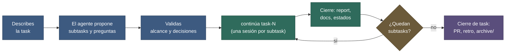

# Uso

**Fecha:** 27 de octubre de 2026 · **Versión del paquete:** 0.7.0

## Contenido

1. [La idea en un minuto](#1-la-idea-en-un-minuto)
2. [El ciclo de vida de una task](#2-el-ciclo-de-vida-de-una-task)
3. [Paso 1: crear la task](#3-paso-1-crear-la-task)
4. [Paso 2: trabajar una subtask](#4-paso-2-trabajar-una-subtask)
5. [Paso 3: cerrar la subtask](#5-paso-3-cerrar-la-subtask)
6. [Paso 4: cerrar y archivar la task](#6-paso-4-cerrar-y-archivar-la-task)
7. [Prompts que funcionan](#7-prompts-que-funcionan)
8. [Cómo leer INDEX.md](#8-cómo-leer-indexmd)
9. [Decisiones](#9-decisiones)
10. [Reports y changelogs](#10-reports-y-changelogs)
11. [Bugs](#11-bugs)
12. [Trabajar en paralelo](#12-trabajar-en-paralelo)
13. [Buenas prácticas y errores frecuentes](#13-buenas-prácticas-y-errores-frecuentes)
14. [Walkthrough con el ejemplo](#14-walkthrough-con-el-ejemplo)
15. [Diagnóstico de salud](#15-diagnóstico-de-salud)
16. [Feedback del método](#16-feedback-del-método)

## 1. La idea en un minuto

Trabajas por **tasks** (un desarrollo completo) divididas en **subtasks** (una sesión de trabajo cada una). Cada subtask tiene un **brief** autocontenido: un archivo que un agente sin memoria puede leer y ejecutar. El estado vive en archivos (`INDEX.md` y el README de la task), no en tu cabeza ni en la memoria del chat. Por eso, para retomar, basta con decir «**continúa task-N**».

| Tú haces | El agente hace |
|---|---|
| Describes qué quieres y apruebas las decisiones que son tuyas | Investiga, propone subtasks, redacta briefs |
| Pides una subtask («continúa task-1») | Lee lo mínimo, verifica el repo real, trabaja |
| Revisas el report y decides qué sigue | Cierra con report, docs, estados y mensaje de commit |
| Commiteas (o se lo pides) | Sugiere el mensaje y anota el hash después |

## 2. El ciclo de vida de una task

**Figura 1.** Ciclo de una task. Azul: planificación contigo. Verde: sesiones de trabajo. Ocre: decisión de cada vuelta. Morado: cierre. Pasos: (1) describes lo que quieres; (2) el agente investiga y propone; (3) validas; (4) cada subtask es una sesión nueva; (5) cada cierre deja el estado escrito; (6) al terminar la última, la task se archiva.

## 3. Paso 1: crear la task

El playbook que usa el agente es [`write-task`](../dev-template/method/playbooks/write-task.md).

1. **Describes lo que quieres** con tus palabras: objetivo, motivo, restricciones, qué queda fuera. Puedes escribirlo en un archivo (`work/tasks/task-N-nombre/task.md`) y adjuntarlo, o decirlo en el chat.
2. **El agente investiga el código y los docs** antes de proponer, y separa hechos verificados de suposiciones.
3. **Te pregunta solo lo que cambia comportamiento, alcance, arquitectura, datos o criterios de aceptación.** Para lo menor propone un valor por defecto marcado «decisión del agente».
4. **Propone subtasks** con dependencias, esfuerzo y modelo sugerido. Tú validas, ajustas o recortas.
5. **Escribe los archivos**:

| Archivo | Contenido |
|---|---|
| `work/tasks/task-N-nombre/README.md` | Objetivo, restricciones, tabla de subtasks con estado, qué necesita de ti (con valor por defecto) |
| `work/tasks/task-N-nombre/decisions.md` | Decisiones con IDs `T<N>-…` |
| `work/tasks/task-N-nombre/subtask-N-descripcion.md` | Un brief por subtask |
| `INDEX.md` | Fila de la task y «Activo ahora» |

Cada brief es **autocontenido**: el agente que lo abra en otra sesión no necesita esta conversación.

Prompt de ejemplo:

> Quiero planificar una task nueva: añadir exportación a CSV del historial. Motivo: el equipo contable lo pide cada mes. No quiero tocar el módulo de facturación. Investiga el código, pregúntame lo imprescindible y propón subtasks. Usa el playbook write-task.

## 4. Paso 2: trabajar una subtask

Abre una **sesión nueva** y escribe una de las frases de entrada ([sección 7](#7-prompts-que-funcionan)). El agente sigue [`start-session`](../dev-template/method/playbooks/start-session.md):

| # | Qué hace | Qué lee |
|---|---|---|
| 1 | Resuelve la frase («continúa task-1» → primera subtask `en curso`, o la primera `pendiente` con dependencias hechas) | `INDEX.md` |
| 2 | Lee la configuración (sin avisar por campos vacíos) | `PROJECT.md`, `DEV-PROFILE.md` |
| 3 | Lee el contexto de la task | README y `decisions.md` de la task |
| 4 | Lee el brief y lo que cita | `subtask-N-*.md`, ADR, restricciones |
| 5 | Lee dónde quedó la subtask anterior (y el report parcial si la actual está en curso) | `work/reports/...` |
| 6 | Lee los docs de las áreas que va a tocar | `docs/<categoría>/...` |
| 7 | **Verifica el repo real** con `git` en cada repo afectado | El repositorio |
| 8 | Confirma en dos líneas qué hará y qué estado encontró | — |
| 9 | Trabaja, con el playbook de lo que toque (`develop-code`, `fix-bug`…) | Código y tests |

Si `INDEX.md` contradice al repo, **manda el repo**: el agente corrige el índice y lo anota en el report.

No lee `work/tasks/archive/` ni reports antiguos salvo que el brief los cite: ese es el ahorro de tokens.

## 5. Paso 3: cerrar la subtask

El agente sigue [`close-session`](../dev-template/method/playbooks/close-session.md) con una lista única de 9 puntos:

| # | Acción | Archivo que toca |
|---|---|---|
| 1 | Verificación y límites (qué se probó, qué no) | Report |
| 2 | Report con «Impacto en docs» y «Siguiente paso» | `work/reports/<task>/subtask-N-*.md` |
| 3 | Docs actualizados, con fecha y «Verificado contra» | `docs/...` y `docs/README.md` |
| 4 | Changelog, solo si cambió código funcional | `work/changelogs/<task>/subtask-N-*.md` |
| 5 | Estado de la subtask: `hecha` | README de la task |
| 6 | «Activo ahora» y fila de la task | `INDEX.md` |
| 7 | Decisiones nuevas; marca resueltas las filas de «Qué necesita del desarrollador» | `decisions.md` / `docs/decisions/` / README |
| 8 | Mensaje de commit sugerido, con ID de task | Report |
| 9 | Preguntas abiertas y desviaciones, en la respuesta final | Chat |

**Qué haces tú:** lees el report (está escrito para ti, con tablas y glosario si lo pediste), respondes las preguntas abiertas y, si quieres, commiteas con el mensaje sugerido. Cuando commitees, pide al agente que anote el hash (`hecha (commit <hash>)`) o escríbelo tú en el README de la task.

Si la subtask **no termina**, el agente la deja `en curso`, escribe un **report parcial** con lo hecho y lo que falta, y lo anota en «Activo ahora». La sesión siguiente lo retoma desde ahí.

## 6. Paso 4: cerrar y archivar la task

Cuando se cierra la última subtask, el agente:

1. Limpia los docs afectados (sin notas provisionales; «verificado contra» al día).
2. Redacta el informe de PR de la task ([`commit-pr`](../dev-template/method/playbooks/commit-pr.md)), si `COMANDOS.md` §3 lo pide.
3. Promueve a `docs/decisions/` (ADR) las decisiones que seguirán rigiendo.
4. Añade una **retro de 3 líneas** (qué funcionó, qué falló o sobró, qué cambiarías del método) como fila `pendiente` en `dev/RETRO.md` y marca «Retro pendiente: sí» en `INDEX.md`.
5. **Archiva**: mueve `work/tasks/task-N-nombre/` a `work/tasks/archive/task-N-nombre/`, corrige los enlaces entrantes y deja la fila como `hecha (archivada)`. Los reports y changelogs no se mueven. El número no se reutiliza.

La retro es tu forma de mejorar el método: cuando haya varias, procésalas con la skill `dev-feedback` ([sección 16](#16-feedback-del-método)).

## 7. Prompts que funcionan

Las frases de entrada están reconocidas por el protocolo (`start-session` §1):

| Situación | Prompt | Qué hace el agente |
|---|---|---|
| Retomar la task | `continúa task-6` | Abre la primera subtask `en curso`, o la primera `pendiente` con dependencias hechas |
| Lo siguiente, sin precisar | `siguiente` | Usa «Activo ahora» de `INDEX.md`; si está vacío, pregunta |
| Una subtask concreta | `subtask 3 de task-6` | Abre esa; si sus dependencias no están hechas, avisa y propone el orden |
| Un bug | `bug-2` | Igual, en `work/bugs/bug-2-*/`, con el playbook `fix-bug` |
| Con brief adjunto | `haz esta subtask @work/tasks/task-6-x/subtask-3-y.md` | El brief manda; contrasta su estado con `INDEX.md` |

Otros prompts frecuentes:

| Situación | Prompt de ejemplo |
|---|---|
| **Primera vez** | `Lee dev/AGENTS.md y revisemos juntos PROJECT.md y COMANDOS.md; anota mis preferencias en DEV-PROFILE.md.` |
| **Retomar tras días** | `continúa task-6. Han pasado dos semanas y hubo cambios de otros en main; verifica el repo antes de seguir.` |
| **Cambiar de dirección** | `Cambio de planes en task-6: ya no usaremos polling, será WebSocket. Actualiza decisions.md, replantea las subtasks pendientes y dime qué cambia antes de tocar nada.` |
| **Pedir solo el estado** | `Resume dónde estamos en task-6 sin modificar nada.` |
| **Cerrar sin terminar** | `Hoy no da para más: deja la subtask 3 en curso con un report parcial.` |
| **Registrar una decisión** | `Decidido: los exports serán UTF-8 con BOM. Regístralo en las decisiones de la task.` |
| **Commit** | `Commitea la subtask con el mensaje sugerido y anota el hash.` |
| **Revisar el método** | `feedback del método` (o `procesa la retro`): la skill `dev-feedback` convierte las filas `pendiente` de `RETRO.md` en propuestas ([sección 16](#16-feedback-del-método)). |
| **Revisar la salud de `dev/`** | `diagnostica dev/` ([sección 15](#15-diagnóstico-de-salud)) |

Si usaste `--adapters claude`, también puedes nombrar la skill: «usa dev-close-session» o «usa dev-diagnose».

## 8. Cómo leer INDEX.md

[`INDEX.md`](../dev-template/INDEX.md) es el tablero. Cinco secciones:

| Sección | Qué te dice | Cuándo mirarla |
|---|---|---|
| 1. Activo ahora | Task en curso, siguiente subtask, rama y repos, última sesión, **pendiente al reanudar** | Antes de retomar; es lo que lee el hook |
| 2. Catálogo de guías | Una línea por playbook: qué hace y cuándo usarlo | Cuando dudes qué guía aplica |
| 3. Tasks | Estado, subtasks hechas / total, último report, siguiente paso, retro pendiente | Para ver todo el panorama |
| 4. Bugs | Igual, para bugs | Idem |
| 5. Backlog | Ideas que aún no son tasks | Al planificar |

**No sustituye a verificar el repo**: si dice una cosa y git otra, vale git y el agente corrige el índice.

## 9. Decisiones

Hay dos niveles ([`record-decision`](../dev-template/method/playbooks/record-decision.md)):

| Nivel | Dónde | Cuándo |
|---|---|---|
| De la task | `work/tasks/task-N-nombre/decisions.md`, IDs `T<N>-D1…` | Decisiones que rigen esa task |
| Global (ADR) | `docs/decisions/ADR-NNN-titulo.md` | Una decisión que una task futura podría incumplir sin saberlo |

Cada fila tiene decisión, motivo, fecha, quién (tú, o «agente (valor por defecto)») y estado (`vigente`, `reemplazada por <ID>`, `promovida a ADR-NNN`). Al cerrar la task, el agente promueve las que siguen vigentes. Qué mirar en el ejemplo: [ADR-001](../examples/mini-proyecto/docs/decisions/ADR-001-solo-localhost.md).

Cuando el agente te hace una pregunta con valor por defecto y no contestas, el valor por defecto se usa y queda marcado como decisión del agente: puedes revisarlas todas en `decisions.md`.

## 10. Reports y changelogs

| Documento | Para quién | Dónde | Cuándo |
|---|---|---|---|
| Report | Tú | `work/reports/<task>/subtask-N-*.md` | Al cerrar cada subtask |
| Plan vs realidad | Tú | `work/reports/<task>/00-plan-vs-actual.md` | Antes de una task grande, para ver la deriva |
| Changelog | Tú y el PR | `work/changelogs/<task>/subtask-N-*.md` | Solo si cambió código funcional |

El changelog se **deriva** de la tabla «Qué cambió» del report; no se redacta otro texto. El report incluye glosario si hay tecnologías en la fila «Tecnologías que NO conozco» de `DEV-PROFILE.md`, diagramas mermaid con epígrafe y un «Siguiente paso» pensado para la sesión siguiente. Lo estable y reutilizable de un report se **promueve** a `docs/` ([`update-docs`](../dev-template/method/playbooks/update-docs.md)); el report conserva la historia, `docs/` el estado actual.

## 11. Bugs

Un bug es como una task pero en `work/bugs/bug-N-nombre/` y con el playbook [`fix-bug`](../dev-template/method/playbooks/fix-bug.md).

- El brief incluye síntoma, pasos para reproducir, esperado frente a observado y causa raíz (o hipótesis marcada como tal).
- El criterio de aceptación exige **una prueba que falla antes del arreglo y pasa después**.
- Cambio mínimo: si el arreglo exige funcionalidad nueva, se abre una task aparte.

Prompt: `bug-3` o `Hay un bug: al exportar con filtros vacíos devuelve 500. Planifícalo como bug según fix-bug.`

## 12. Trabajar en paralelo

| Situación | Regla |
|---|---|
| Dos subtasks que tocan **archivos distintos** y no dependen entre sí | Pueden correr en sesiones o subagentes paralelos; el README de la task marca cuáles |
| Dos subtasks que tocan **el mismo archivo** | No en paralelo: un solo escritor por archivo compartido |
| Una subtask que depende del resultado de otra | Espera; el agente verifica el estado real de la dependencia y no inventa su resultado |
| Varios repos (modo B) | Una subtask puede tocar varios repos; se commitea por repo con el mismo ID de task |

Con subagentes o sesiones paralelas: reparte **dueños de archivos** explícitos en cada prompt («eres dueño solo de X; no edites Y») y deja que el cierre de cada uno actualice sus propios estados. Si dos cierres tocan `INDEX.md` a la vez, revisa el resultado: es el archivo compartido más probable.

## 13. Buenas prácticas y errores frecuentes

| Haz | Evita |
|---|---|
| Una sesión nueva por subtask | Arrastrar horas de chat: el estado ya está en archivos |
| Decir solo la frase de entrada | Re-explicar lo que ya está en el brief, el README o `decisions.md` |
| Responder las preguntas del cierre | Dejarlas sin contestar: se usa el valor por defecto |
| Mantener `INDEX.md` al día (el cierre lo hace) | Editarlo a mano sin avisar al agente |
| Anotar una vez en `DEV-PROFILE.md` lo que no conoces o tu formato de respuesta | Repetir en cada chat «no soy dev front-end» o «respóndeme corto» |
| Dejar lo estable en `docs/` | Llenar `docs/` de planes, pendientes o notas de sesión |
| Ejecutar `python -I dev/.tools/check.py dev` o pedir «diagnostica dev/» tras cambios grandes | Ignorar sus avisos de enlaces o alias |

Errores frecuentes y qué hacer:

| Síntoma | Causa | Solución |
|---|---|---|
| El agente abre la subtask equivocada | `INDEX.md` desactualizado | Pídele que verifique el repo y corrija el índice; o usa «subtask N de task-M» |
| Pregunta un dato (comando de pruebas, formato de commit…) | Está en `—` en `COMANDOS.md`, `PROJECT.md` o `DEV-PROFILE.md` | Contéstale: lo pregunta una vez y lo anota |
| Lee demasiados archivos | No sigue el enrutador | Recuérdale `dev/AGENTS.md`, o nombra el playbook («usa start-session») |
| `docs/` casi vacío | Se omitió «Impacto en docs» en los cierres | Exige el punto 3 de la lista de cierre; pídele promover hechos de los reports |
| Una task cerrada sigue estorbando | No se archivó | Pídele el cierre de task (§6) |
| Los enlaces `@repo/` no resuelven | Alias mal declarado | Revisa `PROJECT.md` §1 y ejecuta `python -I dev/.tools/check.py dev` (o «diagnostica dev/») |

## 14. Walkthrough con el ejemplo

El ejemplo [`examples/mini-proyecto`](../examples/README.md) es un proyecto ficticio («Pendientes») con una task a medias: subtask 1 hecha, 2 en curso, 3 pendiente.

**Montarlo para probar:** sigue la receta de [examples/README.md](../examples/README.md#montar-el-ejemplo-para-probarlo) (da 0 errores y 3 avisos esperados).

**Recorrido** (qué mirar, en orden):

| Paso | Qué abrir | Qué verás |
|---|---|---|
| 1 | [INDEX.md](../examples/mini-proyecto/INDEX.md) §1 | La task activa, la subtask 2 «en curso» y el pendiente al reanudar |
| 2 | [README de la task](../examples/mini-proyecto/work/tasks/task-1-listado-tareas/README.md) | Estado por subtask, restricciones, «Qué necesita del desarrollador» |
| 3 | [decisions.md](../examples/mini-proyecto/work/tasks/task-1-listado-tareas/decisions.md) y [ADR-001](../examples/mini-proyecto/docs/decisions/ADR-001-solo-localhost.md) | Una decisión de la task promovida a global |
| 4 | [Brief de la subtask 2](../examples/mini-proyecto/work/tasks/task-1-listado-tareas/subtask-2-filtros.md) | Las 11 secciones del brief, incluidas restricciones repetidas e «Impacto en docs» |
| 5 | [Report de la subtask 1](../examples/mini-proyecto/work/reports/task-1-listado-tareas/subtask-1-api-crud.md) y [changelog](../examples/mini-proyecto/work/changelogs/task-1-listado-tareas/subtask-1-api-crud.md) | El cierre completo; el changelog repite la tabla «Qué cambió» |
| 6 | [docs/README.md](../examples/mini-proyecto/docs/README.md) | Índice con «léela cuando…» y frescura |

Después, en una sesión de agente sobre ese `dev/`, escribe `continúa task-1`: debe abrir la subtask 2 leyendo `INDEX.md`, el README, el brief y los reports (el de la 1 y el parcial de la 2). **La verificación contra el repo real es teórica en el ejemplo**: los repos y el commit citados no existen.

## 15. Diagnóstico de salud

El playbook [`diagnose`](../dev-template/method/playbooks/diagnose.md) revisa que `dev/` esté sano. En Claude Code lo ejecuta el agente `dev-doctor` (de solo lectura: Read, Grep, Glob y Bash); sin él, cualquier agente puede seguir el playbook.

**Cuándo pedirlo:**

- Tras instalar o actualizar el paquete (para actualizar pide «actualiza dev-guidelines»: la skill `dev-update` ya verifica al final; ver [01-instalacion.md §10](./01-instalacion.md#10-actualizar-a-una-versión-nueva)).
- Al cerrar una task, o después de tocar `INDEX.md` o las tasks a mano.
- Cuando algo parece inconsistente: el agente abre la subtask equivocada, faltan archivos, los enlaces no resuelven.
- Antes de retomar un proyecto parado.

**Cómo:** escribe «diagnostica dev/» (o «audita dev»).

**Qué hace:** ejecuta `python -I dev/.tools/check.py dev --json`, interpreta los hallazgos y revisa lo que el script no ve: que «Activo ahora» coincida con las tasks, subtasks `en curso` sin report parcial, subtasks `hecha` sin commit en el repo, retros pendientes y la versión del paquete.

**Qué devuelve:** un veredicto (`sano`, `con avisos` o `roto`), los hallazgos del más grave al menos (archivo, causa probable y arreglo propuesto), lo que no pudo comprobar y una pregunta única: «¿Aplico estos arreglos?». **No modifica nada hasta que apruebes**; después aplica solo lo aprobado y vuelve a verificar.

## 16. Feedback del método

El método mejora con el uso: cada proyecto acumula sus retros en `dev/RETRO.md` y la skill `dev-feedback` las convierte en propuestas de cambio al paquete.

**Cuándo pedirlo:** tras cerrar varias tasks, cuando `diagnose` lo recomiende (3 o más filas `pendiente`) o cuando notes una fricción repetida. Escribe «feedback del método» o «procesa la retro».

**Qué hace:**

1. Lee las filas `pendiente` de `dev/RETRO.md` y la versión instalada (`dev/.package-version`).
2. Agrupa las parecidas y comprueba contra `dev/method/` que el problema sigue ahí; descarta con motivo las que ya no aplican.
3. Redacta cada propuesta: título, evidencia, archivo del paquete afectado, cambio como parche o texto de issue, y riesgo.
4. Te las muestra y valida contigo una por una o en bloque; solo lo validado se escribe.
5. Guarda lo validado en `dev/.feedback/AAAA-MM-DD-feedback.md` (no se versiona) y marca las filas `propuesta` o `descartada`.

**Qué NO hace todavía:** no toca `dev/method/` ni `AGENTS.md`, no modifica el repositorio del paquete, no crea ramas, no hace commits ni push. Llevar los cambios al repo del paquete lo haces tú; después marca las filas `enviada`. Que la skill arme ramas y empuje con tu confirmación está en el [roadmap (R1)](../release/ROADMAP.md).

Estados de una fila de `RETRO.md`: `pendiente` → `propuesta` → `enviada`, o `descartada`. Las mejoras ya aplicadas al paquete se registran en [historia/retro-aplicadas.md](../historia/retro-aplicadas.md).
