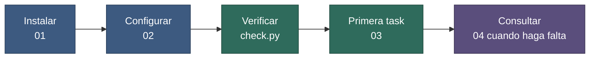

# Documentación de dev-guidelines

**Fecha:** 27 de octubre de 2026 · **Versión del paquete:** 0.7.0

Esta carpeta es para **personas**. La que lee el agente está en [`dev-template/`](../dev-template/) (se instala como `dev/`).

Si solo tienes 5 minutos: [00-quickstart.md](./00-quickstart.md).

## Contenido

1. [Qué es esto](#1-qué-es-esto)
2. [Qué leer según tu objetivo](#2-qué-leer-según-tu-objetivo)
3. [Documentos](#3-documentos)
4. [Camino recomendado](#4-camino-recomendado)

## 1. Qué es esto

Un método para trabajar con agentes de código por **tasks** y **subtasks**, con estado en archivos, documentación técnica como fuente de verdad, informes para ti y un protocolo para retomar con una frase («continúa task-N»). Se instala como una carpeta `dev/` en cualquier repo, o junto a varios.

## 2. Qué leer según tu objetivo

| Quiero… | Lee |
|---|---|
| Instalar y empezar en 5 minutos | [00-quickstart.md](./00-quickstart.md) |
| Instalarlo con una frase al agente (skill `dev-setup`) | [01-instalacion.md §4](./01-instalacion.md#4-vía-skill-dev-setup-recomendada) |
| Instalarlo con un comando (`install.py`, modos A y B) | [01-instalacion.md §5](./01-instalacion.md#5-vía-installpy) |
| Actualizar a una versión nueva (skill `dev-update`) | [01-instalacion.md §10](./01-instalacion.md#10-actualizar-a-una-versión-nueva) |
| Publicar una versión del paquete (mantenedores) | [01-instalacion.md §13](./01-instalacion.md#13-mantener-el-paquete-publicar-una-versión) |
| Configurar mi proyecto y mi perfil | [02-configuracion.md](./02-configuracion.md) |
| Activar skills, reglas o el hook | [02-configuracion.md §9–10](./02-configuracion.md#9-skills-y-reglas) |
| Empezar mi primera task | [03-uso.md §3](./03-uso.md#3-paso-1-crear-la-task) |
| Saber qué decirle al agente | [03-uso.md §7](./03-uso.md#7-prompts-que-funcionan) |
| Retomar un trabajo tras días | [03-uso.md §4](./03-uso.md#4-paso-2-trabajar-una-subtask) |
| Comprobar la salud de `dev/` | [03-uso.md §15](./03-uso.md#15-diagnóstico-de-salud) |
| Entender un archivo, un estado o una convención | [04-referencia.md](./04-referencia.md) |
| Ver el método funcionando | [03-uso.md §14](./03-uso.md#14-walkthrough-con-el-ejemplo) y [examples/](../examples/README.md) |
| Mejorar el método con las retros de mi proyecto | [03-uso.md §16](./03-uso.md#16-feedback-del-método) |
| Saber por qué se diseñó así | [historia/diseno.md](../historia/diseno.md) |
| Ver qué funcionalidades vienen | [release/ROADMAP.md](../release/ROADMAP.md) |

## 3. Documentos

| Documento | Contenido |
|---|---|
| [00-quickstart.md](./00-quickstart.md) | Guía de 5 minutos: instalar, configurar, verificar y primeros prompts |
| [01-instalacion.md](./01-instalacion.md) | Requisitos, vía skill e `install.py`, modos A y B, opciones, adaptadores, git, actualización (`dev-update`, `--status`, `--dry-run`, respaldos), desinstalación, problemas, publicar una versión |
| [02-configuracion.md](./02-configuracion.md) | `PROJECT.md`, `COMANDOS.md`, `DEV-PROFILE.md` y `RETRO.md` campo por campo, qué se lee siempre y qué bajo demanda, alias, stacks, commits, hook, `check.py` y `--json` |
| [03-uso.md](./03-uso.md) | Ciclo de vida de una task, prompts, `INDEX.md`, decisiones, reports, bugs, paralelo, walkthrough, diagnóstico de salud, feedback del método |
| [04-referencia.md](./04-referencia.md) | Mapa de archivos, playbooks (10), estados, convenciones, `check.py`, versionado, glosario |

## 4. Camino recomendado

**Figura 1.** Orden de lectura y de trabajo. Pasos: (1) instalas; (2) revisas `PROJECT.md` y, si quieres, `DEV-PROFILE.md` (`COMANDOS.md` se rellena con lo que se encuentra); (3) verificas con `check.py` (el instalador ya lo ejecuta; más adelante, «diagnostica dev/»); (4) creas tu primera task y trabajas una subtask; (5) usas la referencia para dudas puntuales.
