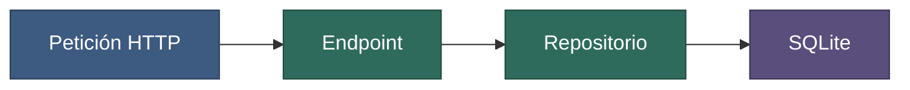

# Task 1, subtask 1 — API para crear y listar tareas

**Fecha:** 2026-03-03
**Rama / repos:** `feat/listado-tareas` en `@back`; commit `a1b2c3d`
**Brief:** [subtask-1-api-crud.md](../../tasks/task-1-listado-tareas/subtask-1-api-crud.md)

## Contenido

1. [Glosario](#1-glosario)
2. [Resumen](#2-resumen)
3. [Qué cambió](#3-qué-cambió)
4. [Verificación](#4-verificación)
5. [Decisiones y desviaciones](#5-decisiones-y-desviaciones)
6. [Impacto en docs](#6-impacto-en-docs)
7. [Siguiente paso](#7-siguiente-paso)
8. [Mensaje de commit sugerido](#8-mensaje-de-commit-sugerido)

## 1. Glosario

| Término | Significado |
|---|---|
| Endpoint | Una dirección de la API que responde a una petición, como una función que se llama por HTTP. |
| Repositorio (patrón) | Una clase que esconde cómo se guardan los datos, para que el resto del código no sepa si es SQLite u otra cosa. |
| 422 | Código HTTP: «los datos enviados no son válidos». |

## 2. Resumen

La API crea y lista tareas y las conserva al reiniciar. Se cumplieron todos los criterios de aceptación del brief.



**Figura 1.** Camino de una petición. Azul: entrada. Verde: código nuevo. Morado: almacenamiento. 1. Llega la petición. 2. El endpoint valida los datos. 3. El repositorio guarda o lee. 4. SQLite persiste en un archivo.

## 3. Qué cambió

| Tipo | Archivo (con alias) | Cambio |
|---|---|---|
| Nuevo | `@back/src/pendientes/models.py` | Modelo `Task` y validación del título. |
| Nuevo | `@back/src/pendientes/repository.py` | Acceso a SQLite aislado de los endpoints. |
| Cambiado | `@back/src/pendientes/main.py` | Endpoints `POST /tasks` y `GET /tasks`; enlace a `127.0.0.1`. |
| Nuevo | `@back/tests/test_tasks.py` | 4 pruebas del núcleo mínimo. |

## 4. Verificación

| Comprobación | Resultado | Evidencia |
|---|---|---|
| `pytest`, `ruff check .`, `mypy src` | pasan | Salida de la sesión |
| `curl` crear y listar | correcto (201 y orden descendente) | Capturas en `work/reports/task-1-listado-tareas/assets/` |
| Título vacío | 422 | Prueba automática |
| Reinicio de la API | las tareas se conservan | Prueba manual |

**No se pudo verificar:** nada.

## 5. Decisiones y desviaciones

| Tema | Decisión o desviación | Motivo |
|---|---|---|
| Orden del listado | Más nueva primero (decisión del agente). | No lo fijaba el brief; es lo más útil para una lista. |

**Preguntas abiertas:** ninguna.

## 6. Impacto en docs

| Página de docs | Cambio |
|---|---|
| [docs/contracts/api-tareas.md](../../../docs/contracts/api-tareas.md) | Creada. |
| [docs/architecture/almacenamiento.md](../../../docs/architecture/almacenamiento.md) | Creada. |

**Hechos estables a promover a docs:** ninguno adicional.

## 7. Siguiente paso

Subtask 2: añadir los filtros `status` y `q` a `GET /tasks`. Primero comprobar que `main.py` sigue devolviendo todo sin parámetros, para no romper el contrato (C3).

## 8. Mensaje de commit sugerido

```
feat(api): create and list tasks with SQLite storage [task-1]

- add Task model with title validation
- add SQLite repository
- add POST /tasks and GET /tasks bound to 127.0.0.1
```
