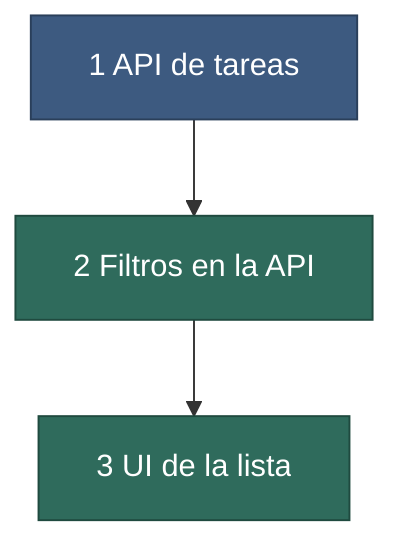

# Task 1 — Listar, crear y filtrar tareas pendientes desde la web

**Fecha:** 2026-03-01
**Estado:** en curso (2026-03-04; subtask 1 hecha, subtask 2 en curso)
**Rama / repos:** `feat/listado-tareas` en `@back` y `@front`
**Origen:** solicitud del desarrollador, 2026-03-01.
**Tasks relacionadas:** ninguna

## Contenido

1. [Objetivo](#1-objetivo)
2. [Decisiones y restricciones](#2-decisiones-y-restricciones)
3. [Plan y dependencias](#3-plan-y-dependencias)
4. [Índice de subtasks](#4-índice-de-subtasks)
5. [Qué necesita del desarrollador](#5-qué-necesita-del-desarrollador)
6. [Backlog (no redactado)](#6-backlog-no-redactado)
7. [Entregables compartidos](#7-entregables-compartidos)

## 1. Objetivo

Hoy las tareas solo se manejan por línea de comandos. Al terminar, el usuario ve en el navegador la lista de tareas, puede crear una y filtrar por estado y por texto. La API en Python hace todo el cálculo; la UI solo dibuja.

## 2. Decisiones y restricciones

Decisiones de esta task: [decisions.md](./decisions.md). Decisiones de todo el proyecto: [ADR-001](../../../docs/decisions/ADR-001-solo-localhost.md).

| ID | Restricción | Origen |
|---|---|---|
| T1-C1 | El filtrado se calcula en la API, no en el navegador. | T1-D2 |
| C1 · C2 · C3 | Restricciones del proyecto ([PROJECT.md §3](../../../PROJECT.md#3-restricciones)). | Proyecto |

## 3. Plan y dependencias

**Figura 1.** Dependencias entre subtasks. Azul: marco (la API base). Verde: funcionalidad. No hay subtasks en paralelo.

1. La subtask 1 deja una API con crear y listar; se demuestra con `curl`.
2. La subtask 2 añade filtros a esa API; se demuestra con `curl` y parámetros.
3. La subtask 3 construye la pantalla que consume la API ya completa.

## 4. Índice de subtasks

Esfuerzo: S horas · M un día · L varios días.

| # | Subtask | Tipo | Resultado | Esfuerzo | Modelo sugerido | Depende de | Estado |
|---|---|---|---|---|---|---|---|
| 1 | [subtask-1-api-crud](./subtask-1-api-crud.md) | marco | `POST /tasks` y `GET /tasks` con almacenamiento en SQLite. | M | El más capaz | — | hecha (commit `a1b2c3d`) |
| 2 | [subtask-2-filtros](./subtask-2-filtros.md) | funcionalidad | `GET /tasks` filtra por estado y por texto. | S | Intermedio | 1 | en curso |
| 3 | [subtask-3-ui-lista](./subtask-3-ui-lista.md) | funcionalidad | Pantalla con lista, formulario y filtros. | M | Intermedio | 2 | pendiente |

## 5. Qué necesita del desarrollador

| Ítem | Necesario para | Valor por defecto del agente mientras tanto |
|---|---|---|
| ¿La búsqueda por texto distingue mayúsculas? | Subtask 2 | No distingue (decisión del agente, T1-D3). |
| Diseño visual de la lista | Subtask 3 | Tabla simple sin estilos especiales. |

## 6. Backlog (no redactado)

| Ítem | Nota |
|---|---|
| Etiquetas por tarea | No pedido en esta task. |
| Editar y borrar tareas | Fuera de alcance; la API solo crea y lista. |

## 7. Entregables compartidos

- Un report por subtask en `work/reports/task-1-listado-tareas/`.
- Docs técnicos actualizados en `docs/` en la misma subtask que cambia el comportamiento.
- Changelog en `work/changelogs/task-1-listado-tareas/` por cada subtask que cambia código funcional.
- Al cerrar la task: informe de PR y actualización de `INDEX.md`.
